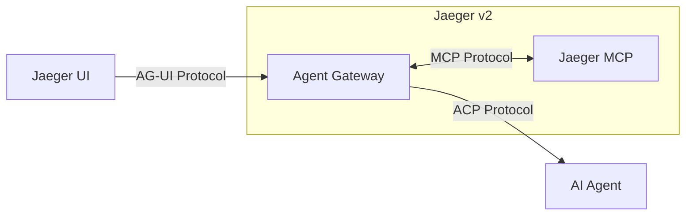

# How Jaeger is evolving to trace AI agents with OpenTelemetry

> A Jaeger maintainer's roadmap post describing a stateless Agent Client Protocol (ACP) layer that turns natural-language constraints into deterministic trace queries, plus local-SLM/production-LLM parity on the same Jaeger v2 binary — useful as a design pattern for constraining AI in SRE tooling, but asserted rather than measured.

## Source Context

- **Type**: blog-post (CNCF Project Maintainer Post)
- **Author credibility**: Jonah Kowall is a Jaeger project maintainer. The post carries maintainer-level provenance and links directly to the upstream Jaeger and OpenTelemetry issues that track each piece of work (backend #8252, #8295; UI #3313; GenAI #8401; OTel semconv #2664, #3583). Credibility on project direction is high; credibility on operational outcomes is not established by this post.
- **Scope**: Covers Jaeger's two-phase evolution — (1) the Jaeger v2 rebuild on the OpenTelemetry Collector, and (2) an agent-collaboration layer built on MCP, ACP, and AG-UI — plus GenAI semantic-convention visualization, the UI workspace changes, and local-versus-production deployment parity. Does NOT cover measured query accuracy, latency, token cost, adoption, failure data, or a shipped-release timeline.
- **Maturity note**: This is a roadmap/design post. The language is consistently forward-looking — "We are building," "the project is exploring," "design and proof of concept." Roadmap items are recorded here as direction of travel, not as shipped, validated features.

## Extracted Claims

### Claim 1: AI-agent execution paths add tracing surfaces that conventional distributed tracing did not need
- **Evidence**: The author enumerates the steps that make up an agent execution path — prompt assembly, vector-database retrieval, and multiple external tool calls — and frames these as the reason observability tools must adapt after microservices and distributed tracing.
- **Confidence**: emerging
- **Quote**: "Mapping the execution path of an AI agent involves prompt assembly, vector database retrievals, and multiple external tool calls."
- **Our assessment**: The list is accurate and matches the corpus's agent-tracing material. It is a framing claim rather than a new finding: distributed tracing already handles nested service calls, but prompt assembly and retrieval add non-service steps that need explicit span modeling. Useful as motivation for why a tracing backend needs GenAI-aware operation types, not as evidence that Jaeger solves them.

### Claim 2: Jaeger v2 replaced its collection layer with the OpenTelemetry Collector and ingests OTLP natively
- **Evidence**: The post describes Jaeger v2 consolidating metrics, logs, and traces into one deployment model and removing intermediate translation by ingesting OTLP directly; it points to the earlier Jaeger v2 release post as the detailed source.
- **Confidence**: settled (architectural fact about Jaeger v2, corroborated by the linked release post)
- **Quote**: "By natively ingesting the OpenTelemetry Protocol (OTLP), the system eliminates intermediate translation steps, improving ingestion performance."
- **Our assessment**: This is the non-speculative foundation of the whole post and the part most likely to hold up. It matters for SRE teams because it means the tracing backend shares the same collector pipeline model as the rest of their telemetry. The "improving ingestion performance" clause is directional; no benchmark is given here.

### Claim 3: Jaeger is adopting three complementary open protocols — MCP, ACP, and AG-UI
- **Evidence**: The post defines each protocol's role: MCP for secure access to external data sources, ACP for UI-to-agent/sidecar communication, and AG-UI for the user-interaction layer. It positions the combination as what lets Jaeger function as an interactive workspace.
- **Confidence**: emerging
- **Quote**: "MCP standardizes how AI models securely access external data sources. ACP provides a uniform method for user interfaces to communicate with AI agents and sidecars."
- **Our assessment**: The protocol split is coherent and reusable: MCP is the data/tool boundary, ACP is the UI-to-agent transport, AG-UI is the interaction event model. Note the post does not justify why three protocols are needed instead of one, nor does it show interoperability testing across them. Record as an architecture choice, not a proven standard stack.

### Claim 4: The ACP backend layer is deliberately a stateless translator between the frontend and external AI sidecars
- **Evidence**: Stated directly as the implementation design, with links to the Jaeger backend issues (#8252, #8295) that document the design and proof of concept.
- **Confidence**: emerging
- **Quote**: "We are building an Agent Client Protocol layer to act as a stateless translator between the Jaeger frontend and external AI sidecars."
- **Our assessment**: This is the most transferable architectural claim in the source. Keeping the tracing backend stateless and pushing model execution to external sidecars means the backend does not become a model host, secret store, or conversation-state owner. It also makes the model swappable (see Claim 7) and bounds the backend's failure domain to translation and query generation. The caveat is that "stateless" is asserted; the post gives no detail on how conversation context is carried or how retries/idempotency work across the boundary.

### Claim 5: Natural-language constraints are translated into deterministic trace queries
- **Evidence**: The post gives a concrete example — 500-level errors in a payment service with latency over 2 seconds — and says the ACP integration parses such constraints and turns them into deterministic trace queries.
- **Confidence**: emerging
- **Quote**: "The ACP integration allows the backend to parse natural-language constraints (such as identifying 500-level errors in a payment service with latency exceeding 2 seconds) and translate them into deterministic trace queries."
- **Our assessment**: The mechanism is plausible and the example is specific, but there is no accuracy measurement: no test set of natural-language constraints, no comparison against hand-written queries, and no false-positive/false-negative analysis. The guide should present this as a design hypothesis — "use the model as a query compiler, keep execution deterministic" — not as a demonstrated NL-to-query capability.

### Claim 6: Restricting the AI to protocol translation and query generation is claimed to bound hallucination risk
- **Evidence**: The author's stated rationale for the architecture: the model is not allowed to reason open-endedly over telemetry, only to translate and generate queries.
- **Confidence**: emerging (design rationale, not measured outcome)
- **Quote**: "By restricting the AI to protocol translation and query generation, the architecture minimizes the risk of hallucinations associated with open-ended chatbots."
- **Our assessment**: This is the post's central design rule and it aligns with the corpus's broader "don't let the LLM own the deterministic decision" pattern. The reasoning is sound: a query compiler has a checkable output (does the query parse and return the expected span set?), whereas an open-ended chat answer does not. But "minimizes the risk" is not quantified — no hallucination rate, no adversarial prompt tests. Treat it as a strong design principle with weak empirical support.

### Claim 7: Cloud LLMs and local SLMs are interchangeable configuration choices, driven by reasoning depth versus data privacy
- **Evidence**: The post states organizations can configure the backend for either cloud LLMs (complex reasoning) or local SLMs (strict data privacy), and that analysis depth depends on the chosen model.
- **Confidence**: emerging
- **Quote**: "Organizations can configure this backend to use cloud-based large language models (LLMs) for complex reasoning or local small language models (SLMs) for strict data privacy."
- **Our assessment**: The trade-off framing is useful and operationally realistic: privacy-sensitive telemetry can stay on-prem with a smaller model, while lower-sensitivity production analysis can use a larger hosted model. The post does not discuss the quality gap between SLM and LLM on query generation, nor the cost model. The guide should record the configuration pattern without claiming equivalence in output quality.

### Claim 8: The UI moves to a streaming assistant workspace that sends trace context to the backend gateway
- **Evidence**: The post names the migration from legacy Redux to Zustand + React Query (UI issue #3313), the in-app assistant stack (assistant-ui + AG-UI), and the streaming flow that sends error logs and key-value tags so the assistant can summarize a failure path within a span.
- **Confidence**: emerging
- **Quote**: "The UI uses streaming events to send trace context (such as error logs and key-value tags) to the backend gateway."
- **Our assessment**: The operational value is reducing manual log reading during an incident, which is consistent with the corpus's incident-response sources. The interesting design detail is that the UI selects and streams *scoped* trace context rather than handing the model the whole telemetry store — another form of constraint. No latency or usability measurements are provided.

### Claim 9: Jaeger will render emerging OTel GenAI semantic conventions for agentic systems and AI sandboxes, without vendor-specific formats
- **Evidence**: The post points to Jaeger issue #8401 and to OpenTelemetry semantic-conventions drafts for Generative AI Agentic Systems (#2664: tasks, memory, actions) and AI Sandboxes (#3583: ephemeral code execution). It commits to mapping those operations in the UI.
- **Confidence**: emerging
- **Quote**: "Jaeger will map these new standard operations in the UI to provide clear visibility into AI execution paths without locking teams into vendor-specific formats."
- **Our assessment**: This is the strongest standards-adoption claim in the post and it corroborates the corpus's vendor-neutral OTel GenAI guidance. The caveat is that the conventions are drafts, so the mapping target can move. The guide should recommend instrumenting to the GenAI semantic conventions and treat backend rendering as an implementation detail, not a reason to adopt a proprietary schema.

### Claim 10: The same Jaeger v2 binary runs locally and in production because it is built on the OpenTelemetry Collector
- **Evidence**: The author connects the historical all-in-one executable to the v2 Collector foundation and states that developers run the exact same binary in both environments.
- **Confidence**: settled (architectural consequence of the v2 rebuild)
- **Quote**: "Because Jaeger v2 is built on the OpenTelemetry Collector, developers run the exact same binary locally as they do in production."
- **Our assessment**: This is a concrete, checkable deployment property and a real reliability win: no separate "dev tracing stack" binary to drift from production. It extends beyond tracing to any collector-based pipeline. The post does not discuss configuration drift, which can still occur even with an identical binary.

### Claim 11: A local SLM in a private sandbox supports testing, then a cloud LLM replaces it for production analysis
- **Evidence**: The post describes running the Jaeger v2 container with a local SLM during testing to avoid exposing data to external APIs, then deploying the same binary in production (often via the OpenTelemetry Operator) and swapping in a larger cloud LLM.
- **Confidence**: emerging
- **Quote**: "During testing, engineers can run the Jaeger v2 container with a local SLM. This creates a private sandbox for testing generative AI traces or debugging ACP integrations without exposing data to external APIs."
- **Our assessment**: This is a practical privacy pattern: keep sensitive test data inside the boundary, and only move to a hosted model where the production data policy allows it. Combined with Claim 10, it gives a coherent local-to-production story. The post does not address what happens when the two models disagree on query generation, which is the main operational risk of model-swapping.

### Claim 12: RAG pipelines and autonomous agents need latency, tool-call, and token metrics, not just trace waterfalls
- **Evidence**: The post lists the measurements developers need — embedding-model latency, external tool calls, and token usage — as the motivation for GenAI-aware visualization.
- **Confidence**: emerging
- **Quote**: "Developers building Retrieval-Augmented Generation (RAG) pipelines and autonomous agents need to measure embedding model latency, track external tool calls, and monitor token usage."
- **Our assessment**: The metric set is sensible and matches the corpus's OTel GenAI attribute work. It is a requirements statement rather than evidence that Jaeger captures these metrics today; the mapping is tied to issue #8401.

### Claim 13: The AI-assistant capability is project direction and proof of concept, not a shipped, validated feature
- **Evidence**: The post repeatedly uses forward-looking language ("We are building," "the project is exploring") and says the design and proof of concept live in Jaeger issues #8252 and #8295. No release version, benchmark, or production deployment is cited.
- **Confidence**: settled (about the post's own maturity)
- **Quote**: "Building on Jaeger v2, the project is exploring new ways for teams to analyze distributed systems."
- **Our assessment**: This claim governs how every other claim should be read. The architectural pattern is worth capturing, but the guide must not present NL-to-trace-query translation, the ACP layer, or the GenAI UI as available and reliable. Re-check the linked issues before promoting any of this to a shipped recommendation.

## Concrete Artifacts

### Artifact 1: Jaeger agent-collaboration architecture (from the post's diagram)

Attributed to the CNCF blog post; the diagram appears as a Mermaid graph in the source.



### Artifact 2: Upstream issue provenance

Extracted from the post's links (roadmap status, not shipped features):

| Area | Artifact | What the post says it covers |
|---|---|---|
| Backend | Jaeger issue #8252 | "Implement AG-UI to ACP Jaeger AI" — design and proof of concept |
| Backend | Jaeger issue #8295 | "Implement ACP-based AI handler" |
| UI | Jaeger UI issue #3313 | Redux → Zustand + React Query migration and the assistant workspace |
| GenAI | Jaeger issue #8401 | "GenAI integration" — visualizing OTel GenAI semantic conventions |
| OTel spec | semantic-conventions issue #2664 | Generative AI Agentic Systems draft — tasks, memory, actions |
| OTel spec | semantic-conventions issue #3583 | AI Sandboxes draft — ephemeral code execution |

### Artifact 3: Deployment and model-selection pattern

Extracted from the "Unified observability: from local testing to production" section:

```
Test / dev:
  Jaeger v2 container (same binary as production)
  + local SLM
  + private sandbox
  → test GenAI traces / debug ACP integrations without external API data exposure

Production:
  Jaeger v2 binary (same binary)
  + OpenTelemetry Operator (Kubernetes)
  + larger cloud-based LLM
  → production incident analysis
  → tracing configuration stays consistent from development to deployment
```

### Artifact 4: ACP request/query flow

Extracted from the "Building the backend protocol layer" section:

```
Jaeger UI  --AG-UI-->  Agent Gateway (stateless)  --ACP-->  external AI sidecar
                              |
                              +--MCP--> Jaeger internals

Natural-language constraint
  ("500s in payment service with latency > 2s")
        ↓
ACP backend parses constraint
        ↓
Deterministic trace query
        ↓
Jaeger MCP returns matching spans/traces
```

## Cross-References

- **Corroborates**:
  - `source-notes/blog-cncf-cloud-native-agentic-ai-security-platform.md` — Claim 3 makes the same architectural move this post makes for query generation: keep the safety verdict deterministic (OPA policy-as-code) and do not put the constraint in the model's prompt ("The instinct to put safety constraints in the reviewer’s system prompt. Don’t."). Claim 4 adds the complementary rule that the downstream decision should receive structured input rather than free-form LLM prose. Jaeger's NL→deterministic-query compiler is the observability analogue.
  - `source-notes/docs-google-sre-prodcast-04-09-ai-agents.md` — Claim 15 states the general rule Jaeger applies locally: do not use an LLM where a deterministic method fits ("One thing I would not use LLMs for is for when you can use a regular expression for things."). Jaeger's restriction of the model to protocol translation/query generation is a concrete instance.
  - `source-notes/docs-datadog-llm-observability.md` — Claim 12 records that a major vendor ingests OpenTelemetry GenAI semantic-convention v1.37+ spans without a proprietary SDK. That independently supports the vendor-neutral standards bet in Jaeger Claim 9.
  - `source-notes/blog-cncf-jaeger-clickhouse-backend.md` — same project and same v2 architecture, different layer (storage backend). No claim-level overlap; it corroborates only that Jaeger v2 is being actively extended, not any AI-assistant behavior.
- **Contradicts**: None identified. The post's constrained-LLM stance is context-conditioned rather than opposed to the corpus's broader AI-SRE material.
- **Extends**:
  - `source-notes/blog-honeycomb-instrumenting-ai-agents-opentelemetry.md` — Honeycomb supplies the concrete agent-instrumentation contract: Claim 2's three required attributes (`gen_ai.conversation.id`, `gen_ai.agent.name`, `gen_ai.operation.name`), Claim 3's rule that a GenAI span is not just an LLM call, and Claim 12's `<operation> <target>` span-naming convention (with the full registry in Artifacts 4–7). Jaeger extends that work at the backend: it proposes rendering those same GenAI operations in a trace UI (Claim 9) and adds a natural-language query layer over the trace store (Claims 4–6). Honeycomb is where the data is produced; Jaeger is where it might be queried and visualized.
  - **Tension worth recording (not a contradiction):** `source-notes/blog-incidentio-ai-sre-incident-run.md` Claim 1 describes an AI SRE that "autonomously begins multi-source investigation" across deploys, telemetry, errors, past incidents, code, and Slack. Jaeger's design deliberately forbids that breadth — the model translates and generates queries, and the backend executes them deterministically (Claims 5–6). These are different products with different trust boundaries (incident-response agent versus trace-exploration assistant), so this is a context-conditioned design choice, not a factual disagreement. The guide should present both and state the condition: open-ended investigation buys coverage at the cost of a harder-to-verify answer; constrained query generation buys determinism at the cost of scope.
- **Novel**:
  - The ACP/AG-UI/MCP three-protocol split for a tracing backend, with a stateless agent gateway in front of Jaeger internals (Claims 3–4). No other note covers ACP or AG-UI.
  - The explicit "model as query compiler" pattern: natural-language constraints → deterministic trace queries, with the model excluded from open-ended reasoning (Claims 5–6).
  - Local-SLM sandbox to production-cloud-LLM swap on the identical Jaeger v2 binary (Claims 7, 10–11).
  - The GenAI semantic-conventions mapping plan for agentic systems and AI sandboxes in a trace UI (Claim 9).

## Guide Impact

- **Chapter 02 (Observability)**: Add a subsection on a natural-language query layer over a tracing backend, framed as "model as query compiler, backend as deterministic executor." Use Claims 4–6: stateless translator, NL constraints → deterministic trace queries, and the hallucination-containment rationale with its evidence caveat. Tie it to the existing OTel GenAI contract from the Honeycomb note (required attributes, span naming) so instrumentation and querying share one schema. Add Claim 9 as the standards-adoption recommendation: map OTel GenAI semantic conventions (agentic systems #2664, AI sandboxes #3583) rather than a vendor-specific operation model.
- **Chapter 03 (Runbooks and Agents)**: Use this source as a concrete example of "structured tool contracts over free-form interfaces." The ACP gateway (Claim 4) and the deterministic query output (Claim 5) show how to keep an agent inside a checkable contract. Pair it with the security-platform note's policy-as-code rule (Claim 3) and the Google AI-agents note's right-tool-for-the-job limit (Claim 15). Also record the incident.io contrast: constrained query generation is appropriate for trace exploration; open-ended investigation is a different product with a different verification burden.
- **Chapter 06 (Security and Trust)**: Add the local-SLM versus cloud-LLM deployment pattern (Claims 7, 11) as a privacy-preserving option for sensitive telemetry: test with a local model in a private sandbox, deploy the same binary in production, and swap to a hosted model only where the data policy allows. State the unresolved risk: model-swap changes query-generation behavior, and the source provides no parity evidence.
- **Chapter 05 (LLM Ops Reliability)**: Note the same-binary local/production property (Claim 10) as a configuration-drift reduction pattern for collector-based pipelines, with the caveat that identical binaries do not guarantee identical configuration.

## Extraction Notes

- **Related-notes candidates reviewed** (all nine, per `miner-related-notes.md`):
  - `docs-google-sre-prodcast-03-07-retail-gaming.md` — dismissed: SLO/retail/gaming operations, no overlap with tracing or AI query layers.
  - `blog-cncf-cloud-native-agentic-ai-security-platform.md` — **cited**: Claims 3–4 corroborate the deterministic-decision-over-prompt pattern.
  - `docs-promptfoo-evaluate-openai-agents-python.md` — dismissed: eval harness and OTLP bridge internals; no overlap with the Jaeger backend query layer or agent-collaboration protocols.
  - `docs-google-sre-eliminating-toil.md` — dismissed: toil taxonomy and automation case studies, unrelated.
  - `docs-google-sre-prodcast-03-13-imperative-declarative.md` — dismissed: change-management paradigms, not observability or agent protocols.
  - `docs-google-sre-reliable-product-launches.md` — dismissed: launch coordination, unrelated.
  - `docs-google-sre-on-call.md` — dismissed: on-call staffing and pager load, unrelated.
  - `docs-google-sre-prodcast-03-01.md` — dismissed: general SRE/OTel adoption discussion (Claim 11 is the closest, but it is about developer mental models, not AI query layers).
  - `docs-litellm-anthropic-advisor-tool.md` — dismissed: model-composition billing/streaming semantics, unrelated to tracing backends.
- **Additional notes reviewed**: `blog-honeycomb-instrumenting-ai-agents-opentelemetry.md` (cited as Extends), `blog-cncf-jaeger-clickhouse-backend.md` (same project, different layer), `blog-incidentio-ai-sre-incident-run.md` (context-conditioned tension), `docs-google-sre-prodcast-04-09-ai-agents.md` (right-tool-for-the-job corroboration), and `docs-datadog-llm-observability.md` (OTel GenAI standards corroboration). The Prospector also named `blog-cncf-otel-mesh-derived-metrics.md` and `blog-cncf-network-boundary-ai-agents-nginx-otel.md`; both mention Jaeger only as an OTel sink and have no substantive overlap, so they are not cited.
- **Quote verification**: All quotes were copied from the fetched source page. Where a sentence includes a parenthetical example or a link, only the contiguous wording is quoted; no quote splices non-adjacent sentences.
- **Deep-read scope**: The post is short and self-contained; the linked Jaeger/OTel issues were not fetched because the post itself frames them as design/PoC tracking and the extraction is explicitly about the stated architecture, not the implementation status. Any future promotion of this note should re-check #8252, #8295, #3313, and #8401 for shipped status.
- **No contradiction issue filed**: The apparent tension with open-ended AI-SRE agents is a difference in product scope and trust boundary, not two claims about the same system; per MINER.md §4a this is a conditioning variable, recorded in Cross-References instead.
