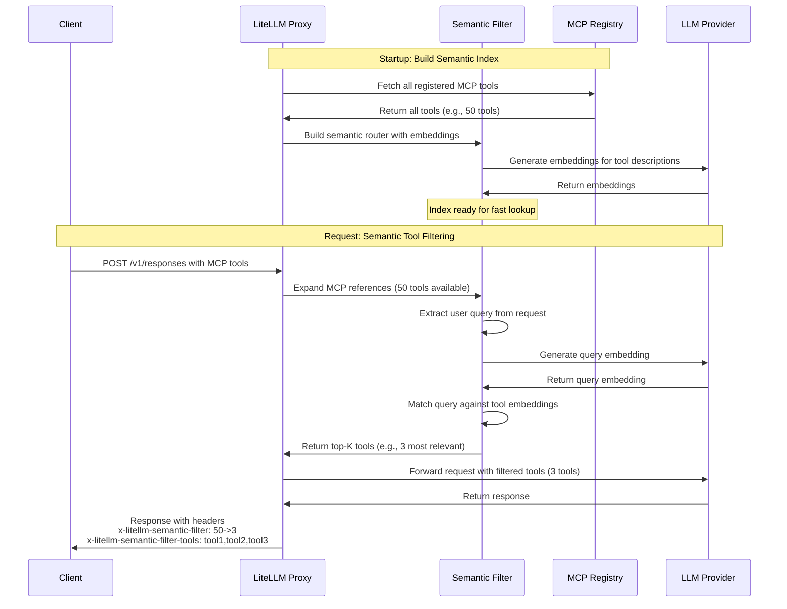

# MCP Semantic Tool Filter (LiteLLM Docs)

> LiteLLM documents an embedding-based retrieval step for MCP tool selection —
> it indexes every registered MCP tool description at startup, embeds the user
> query on each request, and serves only the top-K most similar tools, with
> diagnostic response headers — but the page's blanket fail-open statement
> ("returns all tools if filtering fails") is contradicted by the vendor's own
> merged fail-closed fix for embedding context-window overflow, and the page
> never states how this filter orders against MCP permission filtering.

## Source Context

- **Type**: docs (official vendor documentation — LiteLLM AI Gateway, "MCP
  Semantic Tool Filter" page under "MCP Gateway → Features → Advanced"). The
  page's markdown endpoint (`https://docs.litellm.ai/docs/mcp_semantic_filter.md`)
  reports `last_updated: "2026-11-04"`; `date_published` is not stated.
- **Author credibility**: LiteLLM (BerriAI) first-party product documentation.
  Authoritative for the documented config keys, defaults, request paths, and
  response headers. It publishes no sample sizes, error rates, p99 latencies,
  or failure-mode matrix; the performance and reliability sentences are vendor
  claims without measurement. Longevity caveat: this feature was actively being
  hardened in the vendor's own PRs in July 2026, and this page's failure
  statement is already stale relative to that work (see Claim 7).
- **Scope**: Covers the purpose and three-step mechanism, `litellm_settings.mcp_semantic_tool_filter` configuration and defaults, Responses API and Chat
  Completions usage, diagnostic response headers, a worked 50-tools-to-5
  example, and performance claims. Does **not** cover: how the filter orders
  against the MCP permission hierarchy (`docs-litellm-mcp-control.md`), how it
  interacts with discovery-time guardrail scanning (`docs-litellm-mcp-guardrails.md`),
  which failure classes still fail open after PR #32715, per-key/per-server
  enablement, cost/latency accounting for embedding calls, or an evaluation of
  retrieval quality.

## Extracted Claims

### Claim 1: The feature reframes MCP tool selection as retrieval — index tool descriptions at startup, embed the query per request, return top-K
- **Evidence**: The opening summary, the "How It Works" three-step list, and
  the sequence diagram (startup index build + per-request query embedding).
- **Confidence**: emerging (explicit documented mechanism; no measured retrieval
  quality)
- **Quote**: "Tool search shifts tool selection from a prompt-engineering problem to a retrieval problem. Instead of injecting a large static list of tools into every prompt, the semantic filter:

1. Builds a semantic index of all available MCP tools on startup
2. On each request, semantically matches the user's query against tool descriptions
3. Returns only the top-K most relevant tools to the LLM"
- **Our assessment**: This is the core architectural claim and the reason the
  feature matters for the guide: tool availability becomes a per-request
  retrieval decision rather than a static injected catalog. The wording is
  explicit that the index is built from tool **descriptions**, not input
  schemas or argument text, so relevance is judged on prose alone. The sequence
  diagram adds two operational dependencies the prose understates: tool-description
  embeddings are generated through the LLM provider at startup, and a query
  embedding is generated through the provider on each filtered request.

### Claim 2: The filter is configured globally under `litellm_settings.mcp_semantic_tool_filter` and is disabled by default
- **Evidence**: The `config.yaml` example and the four-item configuration
  options list.
- **Confidence**: settled (explicit config surface and stated defaults)
- **Quote**: "`enabled` - Enable/disable semantic filtering (default: `false`)"
- **Our assessment**: This is a deployment-global switch, not a per-key,
  per-team, or per-server control. Once enabled, one embedding model and one
  `top_k`/threshold pair govern every MCP server and every caller on that proxy.
  Contrast with `mcp_tool_search_enabled`, which is set per virtual key in
  `blog-litellm-save-claude-code-costs.md` Claim 4. For multi-tenant proxies the
  guide should call out that a single global retrieval policy applies to all
  tenants.

### Claim 3: The documented defaults are `embedding_model: "text-embedding-3-small"`, `top_k: 10`, and `similarity_threshold: 0.3` — while the page's own example sets `top_k: 5`
- **Evidence**: The four-item options list versus the YAML example directly
  above it.
- **Confidence**: settled (both values are stated on the page)
- **Quote**: "`top_k` - Maximum number of tools to return (default: `10`)"
- **Our assessment**: Not a contradiction — the example is an explicit override
  of the documented default — but a reader skimming the YAML would assume 5 is
  the default. The Prospector flagged this; the guide should quote the options
  list value (10) as the default and treat 5 as the example's choice. The
  default embedding model is an OpenAI model, so enabling the filter silently
  introduces an OpenAI embedding dependency unless overridden.

### Claim 4: The filter runs automatically on both the Responses API and Chat Completions whenever MCP tools are supplied
- **Evidence**: The "Usage" section and its two curl examples (one per
  endpoint), both using `server_url: "litellm_proxy"`.
- **Confidence**: emerging (documented behavior; only two endpoints shown)
- **Quote**: "Use MCP tools normally with the Responses API or Chat Completions. The semantic filter runs automatically:"
- **Our assessment**: Enabling the setting changes request behavior without any
  client-side signal: the same MCP tool request is silently narrowed. That is a
  meaningful operational property — clients cannot tell from their request that
  tools were removed, only from response headers (Claim 6). The page does not
  say whether other MCP entry points (for example `/mcp` direct calls or the
  REST tool-listing endpoint) are filtered; only these two LLM request paths
  are shown.

### Claim 5: Every response carries a before→after count header and a clipped CSV of selected tool names
- **Evidence**: The "Response Headers" section, its code block, and the two
  explanatory bullets.
- **Confidence**: settled (explicit documented response contract)
- **Quote**: "- **`x-litellm-semantic-filter`** - Shows before→after tool count (e.g., `10->3` means 10 tools were filtered down to 3)
- **`x-litellm-semantic-filter-tools`** - CSV list of the filtered tool names (max 150 chars, clipped with `...` if longer)"
- **Our assessment**: This is the only per-request audit surface the page
  documents. Two limits matter for operations: the name list is clipped at 150
  characters, so with a larger `top_k` the header is not a complete record of
  the served tool set; and the page does not document a log event or metric
  carrying the full selection. The vendor's own fail-closed PR later showed
  that the count header could report `N->N` "success" while filtering had
  actually failed and all tools passed through, so the header must not be
  treated as proof that filtering ran correctly.

### Claim 6: The page claims production optimization — one-time router build, "under 50ms" matching, and no latency impact without MCP tools
- **Evidence**: The "Performance" bullet list. No benchmark method, sample
  size, embedding provider, percentile, or hardware is given.
- **Confidence**: anecdotal (unmeasured vendor performance claim)
- **Quote**: "- Router builds once on startup (no per-request overhead)
- Semantic matching typically takes under 50ms
- No impact on latency for requests without MCP tools"
- **Our assessment**: "Router builds once on startup" is narrowly true and does
  not mean zero per-request work: the sequence diagram shows a query embedding
  call on every filtered request, and that provider round-trip is not included
  in the "under 50ms" figure as described. The claim should be treated as a
  vendor target, not an SLO. For a production latency budget, measure p50/p99
  with the actual embedding provider, including cold start, provider rate
  limits, and the startup embedding batch.

### Claim 7: The page says filtering failures fail open by returning all tools — contradicted by the merged fail-closed fix for embedding context-window overflow
- **Evidence**: The "Performance" bullet states fail-open unconditionally.
  LiteLLM PR #32715 ("fix(mcp): fail closed and surface semantic filter context
  window errors", merged 2026-07-10) documents the opposite behavior after the
  fix: build-time overflow records the failure but registers the hook, and
  later MCP-filtered requests return HTTP 400; query-time overflow also returns
  HTTP 400 instead of passing all tools. The July stability post lists the same
  PR as "semantic filter fail-closed".
- **Confidence**: emerging for the page's statement (stale docs); the opposing
  behavior is settled for the context-window class (merged code + before/after
  reproduction)
- **Quote**: "Fails gracefully - returns all tools if filtering fails"
- **Our assessment**: This is a guide-grade contradiction, not a wording quirk.
  The same component and the same condition (filtering fails) produce opposite
  outcomes: the page says the full tool set is returned; the merged fix says
  the request is blocked with HTTP 400. The page is newer (`last_updated`
  2026-11-04) than the fix (2026-07-10), which suggests stale documentation
  rather than a deliberate reversal, but the two claims cannot both describe
  the current failure contract. The guide must not repeat the fail-open
  statement as a general rule. **Contradiction issue filed: #2039.** The
  remaining uncertainty is which non-overflow failure classes still fail open;
  the page enumerates none and the PR only covers context-window overflow.

### Claim 8: The page claims filtering "increases reliability by reducing tool confusion" with no supporting measurement
- **Evidence**: A single sentence in "How It Works"; no benchmark, task set, or
  error-rate comparison.
- **Confidence**: anecdotal (plausible mechanism, unsupported effect size)
- **Quote**: "This approach improves context efficiency, increases reliability by reducing tool confusion, and enables scalability to ecosystems with hundreds or thousands of MCP tools."
- **Our assessment**: Fewer tools in context can reduce selection errors, but
  retrieval introduces the opposite failure: the correct tool can be dropped
  when the query embedding does not rank it inside `top_k` or above
  `similarity_threshold`. The page reports no measurement of either effect, so
  "increases reliability" should be marked anecdotal. A guide recommendation
  should pair the feature with an eval that measures tool-selection accuracy on
  representative queries, not assume improvement.

### Claim 9: The scalability claim is bounded by the embedding model's input limit, which the vendor's own fix treats as a hard failure mode
- **Evidence**: The same sentence claims scalability to "hundreds or
  thousands" of tools. The "How It Works" step 1 indexes all tools at startup,
  and the sequence diagram shows one batched embedding generation for all tool
  descriptions. PR #32715's reproduction used an 8,192-token embedding input
  limit and a customer-reported 340-tool setup that returned `340->340` on
  query overflow.
- **Confidence**: emerging (mechanism is documented; scale limit is evidenced by
  the vendor PR, not by the docs page)
- **Quote**: "Builds a semantic index of all available MCP tools on startup"
- **Our assessment**: The page presents scale as a benefit without stating the
  binding constraint: tool descriptions are embedded through a model with a
  finite context window, and the query is embedded through the same model. The
  vendor's PR shows this failing at 340 tools for a long query and for an
  oversized tool description. "Hundreds or thousands" is therefore conditional
  on an embedding model with a large enough window and on descriptions short
  enough to batch-embed. The guide should state the constraint alongside the
  scalability claim.

### Claim 10: Selection is per-request and query-dependent, so the served tool set is not a stable allowlist
- **Evidence**: The mechanism list (step 2 matches "the user's query" per
  request) and the worked example that maps a Wikipedia query to the top 5
  tools.
- **Confidence**: emerging (explicit per-request mechanism; non-determinism is
  our inference from embedding retrieval)
- **Quote**: "On each request, semantically matches the user's query against tool descriptions"
- **Our assessment**: This is operationally important: two phrasings of the
  same intent can produce different tool sets, and the same phrasing can shift
  as the tool catalog or embedding model changes. That is not an authorization
  control and should not be treated as one; it narrows what the model sees, not
  what the key is permitted to call. It also complicates reproducibility for
  evals and incident review, because the tool surface is a function of the
  request text plus the indexed catalog at that moment.

### Claim 11: The page never states whether the semantic filter runs before or after MCP permission filtering
- **Evidence**: The "Related" section links to "MCP Permission Management ...
  Control tool access by key/team", but neither that link nor any other passage
  states an ordering or interaction. The config section has no permission-aware
  parameter.
- **Confidence**: emerging (documented absence — this is an open question, not a
  behavior assertion)
- **Quote**: "- [MCP Permission Management](./mcp_control.md) - Control tool access by key/team"
- **Our assessment**: Explicitly **undocumented**, and the guide should say so
  rather than assume safety either way. The two plausible orderings have
  different consequences: filtering before permission intersection could
  retrieve tools a key cannot call (then rely on authorization to reject), while
  permission-filtering before retrieval would only rank permitted tools. The
  page does not say which happens, and it does not state whether retrieval can
  surface tool names (in headers) that the caller is not allowed to call. This
  is the highest-value follow-up for the Assayer/Smith to verify against code.

### Claim 12: The page presents the filter as a context-efficiency optimization and gives no guidance on when NOT to enable it
- **Evidence**: The example claims a 50→5 reduction "dramatically reduces prompt
  size"; the page lists no prerequisites, failure analysis, or opt-out criteria.
- **Confidence**: emerging (documented framing; absence of guidance is the
  observation)
- **Quote**: "This dramatically reduces prompt size while ensuring the LLM has access to the right tools for the task."
- **Our assessment**: "Ensuring" overstates a retrieval heuristic — the feature
  trades guaranteed availability of every permitted tool for a smaller prompt.
  Workloads with small catalogs gain little and add an embedding dependency;
  workloads where a rarely phrased tool is critical risk dropping it. The guide
  should recommend enabling this only after measuring tool-selection accuracy
  and should document a fallback for "tool not found" cases (for example the
  separate `mcp_tool_search` path or a direct tool call).

## Concrete Artifacts

All artifacts are verbatim from the fetched page
(https://docs.litellm.ai/docs/mcp_semantic_filter.md, `last_updated: 2026-11-04`).

### Configuration (`config.yaml`)

```yaml
litellm_settings:
  mcp_semantic_tool_filter:
    enabled: true
    embedding_model: "text-embedding-3-small"  # Model for semantic matching
    top_k: 5                                    # Max tools to return
    similarity_threshold: 0.3                   # Min similarity score
```

### Configuration options (verbatim bullets)

```text
- `enabled` - Enable/disable semantic filtering (default: `false`)
- `embedding_model` - Model for generating embeddings (default: `"text-embedding-3-small"`)
- `top_k` - Maximum number of tools to return (default: `10`)
- `similarity_threshold` - Minimum similarity score for matches (default: `0.3`)
```

### Request-path sequence diagram (verbatim mermaid from the page)



### Diagnostic response headers (verbatim code block)

```text
x-litellm-semantic-filter: 10->3
x-litellm-semantic-filter-tools: wikipedia-fetch,github-search,slack-post
```

### Responses API request with semantic filtering (verbatim curl)

```bash
curl --location 'http://localhost:4000/v1/responses' \
--header 'Content-Type: application/json' \
--header "Authorization: Bearer $LITELLM_API_KEY" \
--data '{
    "model": "gpt-6.1-sol",
    "input": [
    {
      "role": "user",
      "content": "give me TLDR of what BerriAI/litellm repo is about",
      "type": "message"
    }
  ],
    "tools": [
        {
            "type": "mcp",
            "server_url": "litellm_proxy",
            "require_approval": "never"
        }
    ],
    "tool_choice": "required"
}'
```

### Chat Completions request with semantic filtering (verbatim curl)

```bash
curl --location 'http://localhost:4000/v1/chat/completions' \
--header 'Content-Type: application/json' \
--header "Authorization: Bearer $LITELLM_API_KEY" \
--data '{
  "model": "gpt-6.1-sol",
  "messages": [
    {"role": "user", "content": "Search Wikipedia for LiteLLM"}
  ],
  "tools": [
    {
      "type": "mcp",
      "server_url": "litellm_proxy"
    }
  ]
}'
```

### Worked example (verbatim numbered list)

```text
1. Semantically match your query `"Search Wikipedia for LiteLLM"` against all 50 tool descriptions
2. Select the top 5 most relevant tools (e.g., `wikipedia-fetch`, `wikipedia-search`, etc.)
3. Pass only those 5 tools to the LLM
4. Add headers showing `x-litellm-semantic-filter: 50->5`
```

### Performance claims (verbatim bullets)

```text
- Router builds once on startup (no per-request overhead)
- Semantic matching typically takes under 50ms
- Fails gracefully - returns all tools if filtering fails
- No impact on latency for requests without MCP tools
```

## Cross-References

- **Corroborates**: None. No existing source note makes the embedding-based
  retrieval claim; the closest existing mechanism (MCP Tool Search) is a
  different design, cited under **Extends**.

- **Contradicts**:
  - `source-notes/blog-litellm-july-stability-update.md` — **Concrete
    Artifacts → "Key PRs from the MCP credential resolver work"** lists
    `#32715 semantic filter fail-closed`, and the linked PR (merged 2026-07-10)
    documents that embedding context-window failures now return HTTP 400
    instead of passing all tools. That opposes this page's Claim 7 quote
    "Fails gracefully - returns all tools if filtering fails" and its blanket
    framing. **Contradiction issue: #2039.** This source note does not pick a
    verdict; it records both claims and points the Smith/Assayer at the PR.

- **Extends**:
  - `source-notes/docs-litellm-mcp-control.md` **Claim 2** (default open if no
    level defines a list) and **Claim 7** (per-entity `mcp_tool_permissions`
    intersected across levels) — the permission model decides *which tools a
    caller may reach*; the semantic filter decides *which of those the model
    sees on a given request*. This page does not state the ordering between the
    two (Claim 11), so it extends the tool-surface picture without closing the
    composition question.
  - `source-notes/docs-litellm-mcp-guardrails.md` **Claim 7** (discovery-time
    `pre_mcp_call` scan of tool descriptions and input-schema descriptions) —
    both controls act on tool descriptions; the guardrail scans them for
    poisoned content, the semantic filter embeds them for relevance. They are
    adjacent description-time controls with different purposes, and the docs do
    not describe how they order relative to each other.
  - `source-notes/blog-litellm-save-claude-code-costs.md` **Claim 4** and
    **Claim 5** — extends the corpus's MCP tool-selection design space with a
    second mechanism. That note documents `mcp_tool_search_enabled` (two
    virtual tools, token-overlap ranking, "no embedding dependency"); this
    page documents embedding-based top-K retrieval with a required embedding
    provider. The two are complementary options, not the same feature, and this
    source gives up exactly the no-embedding property that note calls out.

- **Novel**:
  - Embedding-based MCP tool retrieval as a first-class gateway feature:
    startup description index, per-request query embedding, top-K + similarity
    threshold, and a global `litellm_settings.mcp_semantic_tool_filter` switch.
  - The diagnostic headers `x-litellm-semantic-filter` /
    `x-litellm-semantic-filter-tools` (including the 150-character clipping of
    the tool-name CSV).
  - The page's blanket fail-open failure statement, and its conflict with the
    vendor's own fail-closed PR — the corpus's first MCP *selection-layer*
    failure-semantics contradiction (as opposed to auth or guardrail failures).
  - The explicit open question of ordering between semantic retrieval and the
    six-level MCP permission intersection.

## Guide Impact

- **Chapter 05 (LLM Ops Reliability — gateway failure semantics and
  observability)**: Add the semantic filter as a request-path feature whose
  failure mode must be verified per version, not assumed. Do **not** repeat the
  page's "returns all tools if filtering fails" as a current contract; cite
  PR #32715 / contradiction #2039 and state that embedding context-window
  failures are fail-closed (HTTP 400) while other failure classes are
  undocumented. Add a runbook/observability note: a `x-litellm-semantic-filter:
  N->N` header is not proof filtering succeeded (the vendor's pre-fix bug
  reported exactly that on overflow), and the tool-name header is clipped at
  150 chars, so full selection auditing needs logs/metrics the page does not
  document.
- **Chapter 06 (Security and Trust — tool-surface governance)**: Frame semantic
  filtering as a *context-efficiency* control, not an authorization control.
  State that it narrows what the model sees but does not change what a key may
  call, and that the ordering versus `mcp_tool_permissions` / the six-level
  intersection (`docs-litellm-mcp-control.md`) is explicitly undocumented
  (Claim 11). Add the retrieval-specific risk: a permitted tool can be hidden
  from the model when it ranks outside `top_k` or below the similarity
  threshold, and the docs claim no measured reliability benefit (Claim 8).
- **Chapter 05 (LLM Ops Reliability), §"A guardrail in the request path is an
  availability dependency"**: Add the semantic filter as a second instance of
  the same pattern — a request-path component that is really a provider call.
  The startup batch embed of all tool descriptions (bounded by the embedding
  model's input limit) and the per-request query-embedding provider call shown
  in the sequence diagram make this a provider-dependency and a cold-start
  concern, not a pure in-process router lookup. The guardrail section's rule —
  give the request-path dependency its own error-rate signal and verify its
  failure semantics — transfers directly, with the caveat from Claim 7 that
  this component's documented failure semantics are stale.

## Extraction Notes

- Primary source read in full from the live Docusaurus `.md` endpoint
  (`https://docs.litellm.ai/docs/mcp_semantic_filter.md`), which exposes the
  page text without navigation chrome and reports `last_updated: "2026-11-04"`.
  The rendered page was also fetched to confirm the same body text. All quotes
  were copied character-for-character from the `.md` body.
- The failure-semantics contradiction was verified at the source, not inferred:
  GitHub PR [BerriAI/litellm#32715](https://github.com/BerriAI/litellm/pull/32715)
  is merged (2026-07-10), is titled "fix(mcp): fail closed and surface semantic
  filter context window errors", and its before/after matrix shows the old
  `x-litellm-semantic-filter: 11->11` HTTP 200 fail-open versus the new HTTP
  400 fail-closed behavior. The July stability post's appendix calls the same
  PR "semantic filter fail-closed". Contradiction issue #2039 was filed before
  this PR, per MINER.md §4a.
- The docs page's example sets `top_k: 5` while the options list documents the
  default as `10`. This is an example override, not a contradiction; it is
  called out in Claim 3 so the Assayer is not surprised by the two numbers.
- Ordering versus MCP permission filtering is **undocumented**, not asserted.
  The page links to `mcp_control` but never states whether retrieval runs before
  or after the permission intersection, and never says whether selection headers
  can name tools the caller cannot call. This is flagged as an open question for
  code-level verification rather than resolved here.
- `miner-related-notes.md` candidates were read before writing
  Cross-References. All ten are LiteLLM docs notes and none documents this
  retrieval feature; each was checked and dismissed as direct corroboration:
  `docs-litellm-batches-api.md` (batch rate limiting),
  `docs-litellm-mcp-deployment.md` (gateway topology/exposure — dismissed as
  direct corroboration; it does not cover tool selection or the filter),
  `docs-litellm-evals-api.md` (managed Evaluations API),
  `docs-litellm-completion-web-search.md` (provider web search),
  `docs-litellm-mcp-zero-trust.md` (JWT signing for MCP calls),
  `docs-litellm-generate-content.md` (Gemini native passthrough),
  `docs-litellm-enterprise.md` (licensing/tiers),
  `docs-litellm-completion-input-params.md` (supported-parameter gate),
  `docs-litellm-files-endpoints.md` (provider `/files` passthrough), and
  `docs-litellm-bedrock-invoke.md` (Bedrock Invoke passthrough). The genuine
  overlaps (MCP control, MCP guardrails, tool search, and the July stability
  update) were found by searching `source-notes/` and are cited above, with
  claim numbers re-verified against each note before writing (§4b).
- `confidence_overall` is `emerging`: the config surface, defaults, request
  paths, and headers are explicitly documented (and some are `settled` at the
  claim level), but the reliability and performance claims are unmeasured vendor
  copy, the failure semantics are stale relative to merged code, and the page is
  a living vendor doc that changed within the last day of this extraction.
- No `guide/` files were edited and `registry/*` was not touched; those are
  Smith/derived artifacts per AGENTS.md.
