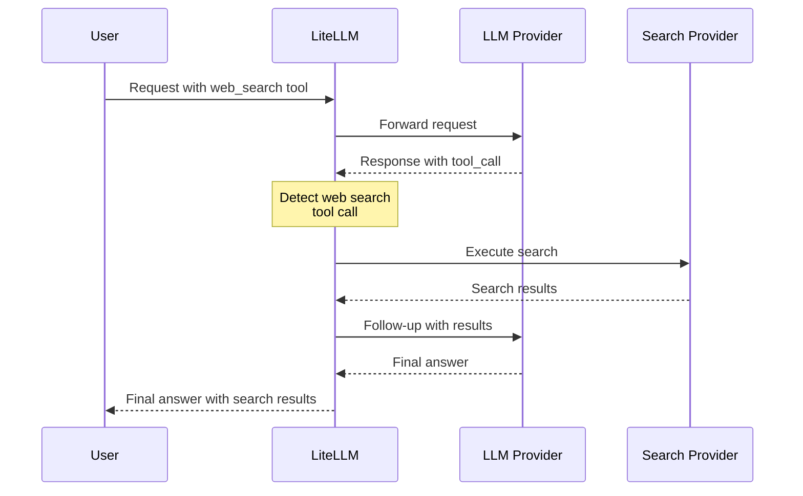

# Web Search Integration / Web Search Interception (LiteLLM Docs)

> LiteLLM's documentation for a **gateway-side callback that turns one client
> request into an agentic loop**: the proxy rewrites whatever search tool the
> caller sent into one canonical `litellm_web_search` schema, executes the
> search against a **separate third-party search vendor** the caller never
> names, and issues a **follow-up model request** with the results. The
> ops-relevant content is not the feature list but four silent rewrites the
> client cannot see — the tool schema is replaced, provider-native tool
> parameters never reach the model, the richer `objective`/`search_queries`
> fields reach only one of twelve search backends, and a provider missing from
> `enabled_providers` turns the feature off **without an error** — plus a cost
> surface that splits across two vendors' invoices and a loop with no
> documented iteration cap, timeout, retry, or budget guard.

## Source Context

- **Type**: docs (vendor documentation — LiteLLM AI Gateway, an integration
  page under "Guides > Integrations"; living page, no publication date).
- **Author credibility**: LiteLLM (BerriAI) first-party product documentation.
  Authoritative for *what the gateway documents* — config keys, the tool
  schema the model sees, the provider tables, the outbound request body, the
  troubleshooting strings. It is capability documentation only: no measured
  latency, no failure writeup, no production experience, no rate-limit or
  fallback guidance for the interception path.
- **Scope**: the interception config surface (`websearch_interception_params`,
  `search_tools`), the request/response rewriting rules, the `litellm_web_search`
  schema the model sees, the per-provider forwarding rules, the search-provider
  and env-var tables, the troubleshooting list, the technical-details section
  (callback architecture, response-format detection, performance bullets), and
  the Claude Code tutorial that consumes the same callback. It does **not**
  cover cost accounting for the interception path, iteration bounds, timeouts,
  retries, fallbacks, prompt-injection handling for search-derived content, or
  domain scoping of the outbound query.
- **Structural position**: this page is the **server-side interception** half of
  the corpus's search story. The sibling note `docs-litellm-completion-web-search.md`
  (#1609) covers *provider-native* search passed through to the model's own
  backend (`web_search_options` / `web_search_preview`), and that note's
  **Scope** section explicitly records `/docs/integrations/websearch_interception`
  as a known unread neighbor. This note closes that gap.
- **Quotation source**: this note quotes the page's **raw markdown endpoint**
  (`https://docs.litellm.ai/docs/integrations/websearch_interception.md`,
  HTTP 200), which preserves the exact tables, code fences, and front matter.
  Every `Quote` from the primary page is a character-for-character contiguous
  fragment from that markdown.
- **Sub-pages followed** (per MINER.md §1, three linked pages):
  - `/docs/search/index.md` (raw markdown, HTTP 200) — the search-provider
    index. Source of the cost-attribution surface (`input_cost_per_query`),
    the search-tool load-balancing rule, and the `object_permission` /
    `search_tool_deny_by_default` access-control surface. Quotes from it are
    attributed inline as *search index*.
  - `/docs/search/parallel_ai.md` (raw markdown, HTTP 200) — the only search
    provider that receives the richer forwarded shape. Quotes attributed
    inline as *Parallel AI page*.
  - `/docs/tutorials/claude_code_websearch.md` (raw markdown, HTTP 200) — the
    consumer tutorial. Quotes attributed inline as *Claude Code tutorial*.
  - The page's other links (`/docs/completion/function_call`,
    `/docs/observability/custom_callback`, `/docs/completion/web_search`,
    `/docs/completion/web_fetch`) were not mined: the first two are already
    covered by corpus notes, the last two are the corpus's existing web-search
    and web-fetch notes.
- **Prospector caveat honored**: the triage flagged that the page documents no
  rate limits, fallbacks, or cost attribution. All three absences are
  confirmed on a full read and recorded as claims (1, 14, 16), not inferred.
  The triage also asserted that provider-native parameters such as
  `allowed_domains` and `max_uses` are "dropped silently"; the page does not
  state that, so it is recorded as an inference from the canonical schema
  (Claim 2), not as a page claim.

## Extracted Claims

### Claim 1: One client request becomes a multi-step agentic loop — two LLM calls plus at least one third-party search-vendor request — and the interception page documents no iteration cap, timeout, retry, or budget guard for it
- **Evidence**: The "How It Works" four-step list, the `mermaid` sequence
  diagram, and the "Performance" bullet list, all on the primary page.
- **Confidence**: settled (the amplification is stated by the vendor);
  settled (negative evidence — a complete read of the primary page and all
  three linked sub-pages found no iteration cap, timeout, retry policy, or
  budget guard on this path)
- **Quote**: "Adds one additional LLM call (follow-up request with search results)"
- **Quote**: "One API call from user → Complete answer with search results"
- **Quote**: "Multiple search queries executed in parallel"
- **Quote**: "Search results can be cached (depends on search provider)"
- **Our assessment**: The vendor's own framing is "one API call from user",
  and the sequence diagram shows three network legs the caller never made:
  LLM → search vendor → LLM. Any per-request latency SLO, timeout, or cost
  model built on "one request = one model call" is wrong by a factor of two on
  the LLM leg and by one vendor round-trip on the search leg. Two details make
  it worse than a flat multiplier: the fan-out ("Multiple search queries
  executed in parallel") means one client request can be N vendor calls, and
  the only caching statement on the page is delegated to the vendor
  ("depends on search provider"), so the gateway has no cache of its own to
  bound either cost or latency. The absence of any bound is the dangerous
  half: the loop's continuation is decided by model output, so a model that
  emits search tool calls repeatedly drives both the vendor bill and the
  follow-up LLM spend, and the page documents nothing that stops it. The
  corpus already has a precedent for the *bounded* version of this control —
  `docs-litellm-a2a-iteration-budgets.md` **Claim 1** documents
  `max_iterations` / `max_budget_per_session` for A2A sessions — so LiteLLM
  clearly has the primitive; this path simply does not use it. The only
  fallback-adjacent surface found anywhere in the three pages is the bare
  phrase "router fallbacks between search tools" in the search index's
  allowlist list, which is never described — so even that is a name, not a
  documented control.

### Claim 2: The gateway replaces whatever search tool the request carries with its own `litellm_web_search` definition before the model sees it — the provider never receives the client's tool contract
- **Evidence**: The "The Search Tool the Model Sees" section, which enumerates
  the replaced tool shapes and states the replacement rule.
- **Confidence**: settled (explicit vendor statement)
- **Quote**: "Whatever web search tool the request carries, LiteLLM replaces it with its own `litellm_web_search` definition before the model sees it."
- **Quote**: "Anthropic's `web_search_20250305`, the Responses API's `web_search_preview`, Claude Code's `web_search`, and a `litellm_web_search` function tool you define yourself with only a `query` parameter all reach the model as the schema below, in the tool format of the API you called (an Anthropic `input_schema`, a Chat Completions `function.parameters`, or a flat Responses function tool)."
- **Our assessment**: This is the sharpest client-unaware contract change in
  the corpus: the request the model answers is not the request the client
  sent, and the client is told neither. It is the same class as
  `docs-litellm-messages-to-responses-mapping.md` **Claim 7** (Anthropic
  web-search tools type-remapped to `{"type": "web_search_preview"}`, tools
  and `tool_choice` "type-remapped, not passed through"), but at a much
  larger scope: one rule covers four different client tool shapes plus a
  user-defined function tool. One consequence the page does **not** spell out
  is what happens to provider-native tool parameters that are not in the
  canonical schema — Anthropic's `allowed_domains`, `max_uses`, and
  `citations.enabled` on `web_fetch_20250910`, or `max_uses` on
  `web_search_20250305`, have nowhere to go once the schema is replaced.
  That is our inference from the canonical three-field schema (Claim 3), not
  a page statement; the page never says "dropped". The guide should carry it
  as "the tool contract is rewritten, so client-side tool parameters are not
  guaranteed to reach the model", which is the operational claim, and should
  not assert a specific drop without a source.

### Claim 3: The canonical schema the model sees is three fields — `query` required, `objective` and `search_queries` optional — and the field descriptions are instructions to the model
- **Evidence**: The `litellm_web_search input schema` JSON block and the
  paragraph that follows it.
- **Confidence**: settled (explicit schema)
- **Quote**: "`query` is required and is what most search providers receive. `objective` and `search_queries` are optional: they let the model say what it is after and fan out several keyword searches in one tool call."
- **Quote**: "Natural-language description of the goal behind the search, including any source or freshness requirements."
- **Quote**: "Two to five short keyword queries (3-6 words each) covering different angles of the objective, e.g. varying names, synonyms, or phrasings. Provide together with objective for the best results."
- **Our assessment**: Two things to note. First, the absence of any
  domain-scoping or freshness-control field: the only egress-relevant knob is
  `objective`, a free-text natural-language description. Compare the corpus's
  web-fetch note (`docs-litellm-completion-web-fetch.md` **Claim 3**), where
  `allowed_domains` / `blocked_domains` are the *only* domain-scoping
  controls the page documents — on the intercepted search path there is no
  such field at all, so an operator cannot restrict which domains the search
  vendor returns. Second, the schema descriptions are prompt text: the
  quality of the fan-out depends on a model following a vendor-authored tool
  description ("3-6 words each", "Provide together with objective for the
  best results"). That makes search quality a model-behavior variable on a
  path the operator believes they configured. The schema also constrains the
  model to "two to five" queries while the forwarding cap keeps only five —
  consistent, but it means the model's stated range and the enforced cap
  happen to agree today rather than by design.

### Claim 4: For a client that sent an Anthropic-native `web_search_*` tool, the final response's `server_tool_use` block still shows only `query` — the response is narrower than the request
- **Evidence**: The closing sentence of the "The Search Tool the Model Sees"
  section.
- **Confidence**: settled (explicit vendor statement)
- **Quote**: "For clients that sent an Anthropic-native `web_search_*` tool, the `server_tool_use` block in the final response still shows only `query`."
- **Our assessment**: The visibility is asymmetric in the worst direction: the
  request that reached the model carried three fields, but the tool-use record
  the client receives shows one. A client that audits what it asked for by
  reading `server_tool_use` will conclude that no fan-out and no objective
  were involved even when the vendor received all three (and, on Parallel,
  executed five queries). So the response payload cannot be used to audit the
  interception, and any dashboard built from the response's tool-use blocks
  will under-report the vendor calls. This is the concrete form of "the
  gateway is changing your request and you cannot see it in the answer".

### Claim 5: `objective` and `search_queries` are forwarded to Parallel AI only — every other search provider receives the single `query` string, with no signal in the response
- **Evidence**: The forwarding paragraph on the primary page, plus the
  "Web Search Interception" section of the Parallel AI page, which states the
  exclusivity explicitly.
- **Confidence**: settled (explicit vendor statement on two pages)
- **Quote**: "LiteLLM forwards them only to search providers whose API takes that shape natively"
- **Quote**: "Parallel AI is the only search provider that receives this richer shape today; every other provider gets the tool call's single `query`."
- **Quote**: "Every other search provider (Perplexity, Tavily, Exa, and the rest) keeps receiving the single `query` string, and a model that fills only `query` behaves exactly as before on every provider."
- **Our assessment**: This is a configuration-dependent correctness variable
  with no client-visible difference. The same model output produces a
  one-query search on Tavily and a five-query fan-out on Parallel, and the
  client's response is indistinguishable between the two deployments. The
  guide's rule should be: **the search backend's capabilities are part of the
  request contract, and switching `search_provider` changes what the model
  can actually do** — so a search-provider migration is a behavior change
  requiring re-validation of the model's tool usage, not just a credential
  swap. It also inverts the vendor's marketing shape: the page's own
  "Parallel AI Search" example is the only place a fan-out exists, so the
  headline capability is available on exactly one of twelve backends.

### Claim 6: The optional fields are validated before forwarding — a blank `objective` is ignored, a non-array `search_queries` is ignored (not split), non-string entries are dropped, and only the first five are kept
- **Evidence**: The validation paragraph on the primary page and the cap
  restatement on the Parallel AI page.
- **Confidence**: settled (explicit validation rules)
- **Quote**: "The optional fields are validated before they are forwarded: a blank `objective` is ignored, `search_queries` has to be an array (a bare string is ignored rather than split into characters), entries that are not non-empty strings are dropped, and only the first five queries are kept, matching Parallel's own cap."
- **Quote**: "LiteLLM then sends Parallel the model's `objective` and up to five of its `search_queries`; queries past the fifth are dropped before the request goes out, matching Parallel's cap."
- **Our assessment**: Three silent degradations, each a plausible model
  mistake: a blank objective is dropped, a malformed `search_queries` string
  is dropped *entirely* rather than coerced (the page explicitly says it is
  "ignored rather than split into characters" — a good defensive choice that
  still produces a silent downgrade from fan-out to single-query), and a
  sixth query never leaves. Each of these makes the search *worse* while
  leaving the request successful. The corpus already has this class of
  finding in the same vendor's surface area:
  `docs-litellm-completion-input-params.md` **Claim 6** records a `stop` list
  longer than four sequences silently truncated to the first four. The
  pattern to carry into the guide: **LiteLLM's request-mutating normalizers
  are silent and non-erroring, so "the request succeeded" is not evidence
  that "the request you meant was executed"** — for truncation and coercion
  there is no field in the response to check.

### Claim 7: A tool-level `litellm_params.objective` overrides the model's `objective` on every request
- **Evidence**: The forwarding paragraph on the primary page and the
  override rule on the Parallel AI page.
- **Confidence**: settled (explicit vendor statement on two pages)
- **Quote**: "unless the search tool's `litellm_params` already sets an `objective`, which is kept over the model's."
- **Quote**: "An `objective` set in the search tool's `litellm_params` is kept on every request and the model's is dropped."
- **Our assessment**: The gateway config wins over model output, silently and
  on every request. Two consequences: (a) a search tool configured with an
  objective is a **global semantic override** — the model can no longer
  express what it actually wants, and the final answer is produced under an
  objective the model never chose; (b) the operator cannot tell from the
  response whether the objective in play was the model's or the config's,
  because the response's `server_tool_use` shows only `query` (Claim 4). The
  guide's rule for any gateway that rewrites a model-authored field: the
  override must be observable somewhere (log line, response field), or it is
  an unreviewable semantic edit to every request on that route.

### Claim 8: `enabled_providers` is a client-visible behavior switch — a provider that is not in the list means interception never runs and the caller receives the model's raw `tool_calls`
- **Evidence**: The "Common Issues" subsection of the page's Troubleshooting
  section.
- **Confidence**: settled (explicit vendor statement)
- **Quote**: "Model returns tool_calls instead of final answer"
- **Quote**: "Provider not in `enabled_providers` list"
- **Quote**: "Add provider to `enabled_providers`"
- **Our assessment**: The failure presents as *model behavior* — a model that
  decided to call a tool instead of answering — when it is in fact a gateway
  configuration error. The request succeeds, the status is 200, and the
  response is a well-formed tool call the caller did not ask for. The
  operator debugging this will look at the model and the prompt first, not at
  the gateway's provider list. Note the asymmetry inside the same
  Troubleshooting list: the sibling misconfiguration (`search_tools` empty) is
  *loud* — "No search tools in `search_tools` config" / "Add at least one
  search tool configuration" — so the two halves of the same config surface
  fail in opposite ways, and the silent half is the one an operator hits
  when they add a provider to `model_list` and forget `enabled_providers`.
  This belongs with the corpus's silent-fallback family
  (`docs-litellm-completion-web-search.md` **Claim 8**, where
  `supports_web_search: False` does not drain a deployment) and with Ch05's
  "silent model fallback breaks attribution" rule: a behavior change that
  arrives without an error is a routing event that needs a signal.

### Claim 9: Search-tool selection is order-dependent by default and can be nondeterministic — the first entry of `search_tools` wins when `search_tool_name` is unset, and same-named tools are picked at random with the router's routing strategies inapplicable
- **Evidence**: The "How Search Tool Selection Works" section on the primary
  page and the "Load Balancing" section of the search index.
- **Confidence**: settled (explicit vendor statement on both pages)
- **Quote**: "**If `search_tool_name` is not specified** → Uses first search tool in `search_tools` list"
- **Quote**: "Specific search tool from `search_tools` config. If not set, uses first available."
- **Quote**: "Give multiple search tools the same `search_tool_name` to load balance across them. Each request picks one of the matching tools at random. `router_settings.routing_strategy` does not apply to search tools, so strategies like `least-busy` or `latency-based-routing` have no effect on which provider serves a search request"
- **Our assessment**: Two distinct selection rules, both silent. By default,
  **YAML list order is production configuration**: reordering `search_tools`,
  or inserting a tool at the top of the list, silently changes which vendor
  every unconfigured route searches through. And the documented way to spread
  load (duplicate the `search_tool_name`) makes the backend a per-request
  coin flip, while the router strategies an operator would reach for
  (`least-busy`, `latency-based-routing`) are explicitly inert for search
  tools — a knob that exists, looks applicable, and does nothing. The
  contrast with the corpus's routing material is sharp and worth stating in
  the guide: `blog-litellm-auto-router-v2.md` **Claim 5** records that
  LiteLLM's model router escalates to the *highest* matched tier precisely so
  "rule order does not silently change behavior", and **Claim 3** makes
  debuggability the stated rationale ("predictable beats clever for
  debuggability"). The search-tool selector does the opposite on both
  counts, and unlike the model router it publishes no per-request decision
  log (`blog-litellm-auto-router-v2.md` **Claim 8**) naming which tool
  answered. The guide's rule: a search provider selection must be explicit
  and recorded per request, or "which vendor served this query" is
  unanswerable after the fact.

### Claim 10: Twelve search providers are supported, each with its own credential — and the page's provider table and the page's own config examples disagree on two of the environment-variable names
- **Evidence**: The "Search Providers" table, the Quick Start `config.yaml`,
  and the "Complete Configuration Example" `config.yaml`, all on the primary
  page.
- **Confidence**: settled (both strings are on the page, verbatim, and
  mutually inconsistent)
- **Quote**: "`PERPLEXITYAI_API_KEY`"
- **Quote**: "api_key: os.environ/PERPLEXITY_API_KEY"
- **Quote**: "`PARALLEL_AI_API_KEY`"
- **Quote**: "api_key: os.environ/PARALLEL_API_KEY"
- **Our assessment**: A concrete, checkable configuration defect with an
  operational cost. The page's table says Perplexity's variable is
  `PERPLEXITYAI_API_KEY`; the page's own Quick Start uses
  `PERPLEXITY_API_KEY`. The table says Parallel's is `PARALLEL_AI_API_KEY`;
  the page's own Complete Configuration Example uses `PARALLEL_API_KEY`. An
  operator who copy-pastes the page's example gets a missing credential for
  two of the three example providers, and the failure does **not** surface at
  config load — it surfaces inside the interception loop, after the first LLM
  call has already been billed, because the search vendor is called mid-loop.
  The drift is systemic rather than a one-off typo: the linked search index
  carries the same split (its provider table says `PARALLEL_AI_API_KEY`
  while its SDK note says "To use Parallel AI Search, set `PARALLEL_API_KEY`"),
  and the Claude Code tutorial's Parallel block uses `PARALLEL_API_KEY` too.
  The guide's rule for any vendor-doc config surface: **resolve the
  credential name from the provider table, not from the example**, and
  smoke-test one intercepted request end-to-end (query → vendor → follow-up
  answer) rather than asserting that the proxy boots.

### Claim 11: Egress — the search query, and on Parallel the model-authored `objective` and `search_queries`, leave the gateway for a third-party search vendor selected by gateway config, not by the caller
- **Evidence**: The "How It Works" step list, the `search_tools` config
  surface, and the schema descriptions for `objective` and `search_queries`.
- **Confidence**: settled (explicit vendor statement and config surface)
- **Quote**: "the search using your configured search provider"
- **Quote**: "Natural-language description of the goal behind the search, including any source or freshness requirements."
- **Our assessment**: Two data-egress facts the guide's security chapter
  needs. First, the search vendor is chosen entirely by the gateway
  operator — the caller sends a tool call, not a vendor, and cannot observe
  which vendor answered (Claim 4). Second, the egress payload is **not just
  the query string**: `objective` is explicitly "Natural-language
  description of the goal behind the search", i.e. a restatement of what the
  user wants, and `search_queries` are short keyword phrasings derived from
  the same prompt. So the data that crosses the boundary to a non-LLM vendor
  can be a paraphrase of the user's intent rather than the literal query —
  which matters for a data-governance review that reasons about "what text
  left the perimeter". The gateway holds the vendor credential
  (`api_key: os.environ/…` under `search_tools`), so the search vendor is a
  second processor with its own contract, its own retention, and its own
  invoice, reached by a gateway the model provider never sees.

### Claim 12: The mechanism is a gateway callback with a pre-request hook, a post-response hook, and an agentic loop; the loop detects the tool call by sniffing the response shape
- **Evidence**: The "Technical Details → Architecture" section and the
  "Response Format Detection" subsection.
- **Confidence**: settled (explicit vendor statement)
- **Quote**: "Web search integration is implemented as a custom callback (`WebSearchInterceptionLogger`) that:"
- **Quote**: "Converts native web search tools to LiteLLM standard format"
- **Quote**: "Detects web search tool calls in responses"
- **Quote**: "Executes searches and makes follow-up requests automatically"
- **Quote**: "`tool_calls` in assistant message"
- **Quote**: "`tool_use` blocks in content"
- **Our assessment**: Two architectural facts. First, this is a **callback in
  the gateway's hook chain** — architecturally the same position as a
  gateway-attached guardrail, which Ch06 already treats as a third-party
  component in the request path whose failure semantics are the gateway's
  (see `docs-litellm-generic-guardrail-api.md` **Claim 8** for that
  fail-closed/fail-open knob set). The difference here is that the
  interception's callback makes a *second model call*, so its failure
  semantics compound into cost and latency, not just availability. Second,
  detection is **response-shape sniffing** across two wire formats
  (`tool_calls` in an assistant message vs `tool_use` blocks in content).
  That means two code paths must agree about when to run the loop, and the
  page documents neither a fallback for a response in neither shape nor what
  happens when the shape is recognized but the tool is not the gateway's.

### Claim 13: Streaming is supported but "automatically converted" — the client-visible stream is not the provider's stream, and the conversion's semantics are undocumented
- **Evidence**: The "Supported APIs" list under "Technical Details".
- **Confidence**: settled that the page states "automatically converted" and
  nothing more; the operational consequences below are our inference, flagged
  as such.
- **Quote**: "**Streaming** (automatically converted)"
- **Our assessment**: The page says nothing about what is converted to what,
  whether the *follow-up* request is streamed, whether chunk boundaries or
  the `finish_reason` are preserved, or whether usage arrives in the
  converted stream. Those omissions sit on top of a corpus that already
  documents that streamed traffic is usage-blind by default
  (`docs-litellm-completion-input-params.md` **Claim 9**: usage arrives as an
  extra chunk before `data: [DONE]` with an empty `choices` array, and every
  other chunk carries `usage: null`) and that a tripped stream never delivers
  its usage chunk (`docs-litellm-completion-stream.md` **Claim 12**), with a
  usage-only-chunk carve-out that exists precisely because of Vertex Gemini
  with web search (`docs-litellm-completion-stream.md` **Claim 9**). An
  operator cannot assume the usage-chunk contract of their own provider's
  stream on a converted one. The guide's rule: **on a gateway path that
  converts streaming, verify where usage lands before building spend
  reconciliation on it** — do not assume the provider's stream contract
  survives the gateway's rewrite.

### Claim 14: The interception path documents no cost surface at all — but the sibling search page shows how search spend *can* be attributed: a per-search-tool `input_cost_per_query` that overrides the cost-map price, drives `x-litellm-response-cost` and the spend logs, and is billed once per query
- **Evidence**: Absence across the primary page (no cost, spend, price, or
  billing text anywhere in the interception content), against the "Custom
  Per-Query Pricing" section and the feature table of the search index.
- **Confidence**: settled (the absence on the primary page is from a complete
  read; the attribution surface is explicitly documented on the linked
  search index)
- **Quote**: "Set `input_cost_per_query` under a search tool's `litellm_params` to charge your own price per search query. LiteLLM uses it instead of the cost map price for that tool, so `x-litellm-response-cost` and the spend logs match the rate you pay. It works for every search provider, and a tool without it keeps the provider's cost map price."
- **Quote**: "A request with a list of queries is billed once per query. A price of `0` is kept as a free tool, not treated as unset."
- **Quote**: "Cost Tracking | ✅"
- **Our assessment**: This answers the triage's cost-attribution question
  partially, and the shape of the answer matters. The interception page says
  nothing about cost, so an operator reading only it has no idea that a
  vendor bill exists on this path. The attribution surface exists one page
  over, on the search-tools config: a per-tool `input_cost_per_query` that
  replaces the cost-map price and feeds the response-cost header and the
  spend logs. Three consequences: (a) the search vendor spend is
  **attributable, but in the spend log and `x-litellm-response-cost` — not in
  the response's `usage` object**, so the token-usage accounting the corpus
  already uses (`docs-litellm-token-usage-helpers.md` **Claims 1** and **4**:
  local estimator, no provider-side reconciliation) will not see it; (b)
  **a request with a list of queries is billed once per query**, so a
  five-angle fan-out on one client request is five vendor charges on top of
  two LLM calls — the amplification is metered, which means it *can* be
  alerted on if the operator wires it; (c) the `0` price rule is an audit
  trap — a tool priced `0` is kept as free rather than treated as unset, so a
  mistyped or default-zero price silently produces zero-cost search. Contrast
  with the provider-native path's idiom
  (`docs-litellm-completion-web-search.md` **Claim 14**:
  `litellm.completion_cost(completion_response=response)` is where token cost
  and search cost are combined); on the intercepted path there is no such
  idiom — the two cost components land in different places and are only
  added up in the vendor's own bill.

### Claim 15: The interception path has a fail-closed authorization control that the interception page never mentions — `object_permission.search_tools` plus `search_tool_deny_by_default`, denying with a 403 before any search provider is called
- **Evidence**: The "Restrict Search Tool Access" section of the search index.
- **Confidence**: settled (explicit vendor statement, with an error-code list
  and a resolution table)
- **Quote**: "Set `search_tools` under `object_permission` on a key or team to limit which search tools it can call. The allowlist applies to `/search`, `/v1/search`, `/search/{search_tool_name}`, web search interception, router fallbacks between search tools, and `/search_tools/list`"
- **Quote**: "Denied requests return `403` before any search provider is called, with `key_search_tool_access_denied`, `team_search_tool_access_denied`, or `user_search_tool_access_denied`"
- **Quote**: "By default an empty or missing `search_tools` list allows every search tool."
- **Quote**: "Web search interception with no registered search tool stops falling back to the default provider for every restricted caller, since there is no tool name a grant could list."
- **Quote**: "The master key and dashboard login sessions are not restricted."
- **Our assessment**: This is the one hard control on the path, and the
  default posture is **allow-all**: "By default an empty or missing
  `search_tools` list allows every search tool", and the deny-by-default flag
  "defaults to `false`". So out of the box, any key on the gateway can drive
  egress to any configured search vendor, with the gateway's credential. That
  is the same "default is the wide path" pattern the corpus already flags
  elsewhere in LiteLLM's config surfaces (e.g.
  `docs-litellm-completion-web-search.md` **Claim 7**: a deployment-level
  `web_search_options: {}` turns search on for every caller of that model).
  Two operational notes: (a) the allowlist applies to "web search
  interception" explicitly, so this is a real authorization point on the
  path — the failure is loud (403) and the error code distinguishes key,
  team, and user denial; (b) turning `search_tool_deny_by_default` on has a
  side effect the interception page does not mention — interception "stops
  falling back to the default provider for every restricted caller, since
  there is no tool name a grant could list", i.e. restricted callers lose
  search entirely. The corpus's `docs-litellm-gateway-auth-reference.md`
  **Claim 7** documents that authorization resolution depth is already
  asymmetric across LiteLLM surfaces (MCP six levels, A2A two); search tools
  add a third surface with its own resolution table (key; key and team; the
  team the request resolved to; the user).

### Claim 16: The three pages that document this feature disagree with each other on the search-provider inventory, and the search index's own feature table contradicts its own body on load balancing
- **Evidence**: The interception page's search-provider table (12 entries), the
  Claude Code tutorial's table (9 entries), the search index's
  "Supported Providers" list (19 values), and the search index's feature
  table versus its "Load Balancing" section.
- **Confidence**: settled (all counts and both strings are verbatim on the
  pages)
- **Quote**: "Load Balancing | ❌"
- **Quote**: "Give multiple search tools the same `search_tool_name` to load balance across them."
- **Our assessment**: Recorded, not resolved — the same posture the corpus
  takes for the provider-native page's model-identity drift
  (`docs-litellm-completion-web-search.md` **Claim 16**). The consequence is
  practical: an operator auditing "which search backends can this gateway
  use?" must enumerate the provider list per page, because a backend present
  in the search index (DuckDuckGo, You.com, APISerpent, Bedrock AgentCore,
  Nimble, Bing grounding, DeepSeek — 7 that the interception page does not
  list) may or may not be usable as a `search_provider` behind the
  interception callback. And the search index's feature table says load
  balancing is unsupported while its body documents a load-balancing
  mechanism — the support-matrix genre's known unreliability, which the
  corpus records for the same vendor's other pages
  (`docs-litellm-completion-web-fetch.md` **Claim 7** for model-table vs
  example drift). Per MINER.md §4a this is a vendor-documentation
  inconsistency, not a disagreement between two corpus sources, and it does
  not change guide advice, so no contradiction issue was filed.

## Concrete Artifacts

All artifacts below are verbatim from
`https://docs.litellm.ai/docs/integrations/websearch_interception.md` (raw
markdown endpoint), unless a different source page is attributed.

### The tool schema the model sees (page, "The Search Tool the Model Sees")

```json title="litellm_web_search input schema"
{
  "type": "object",
  "properties": {
    "query": {
      "type": "string",
      "description": "The search query to execute"
    },
    "objective": {
      "type": "string",
      "description": "Natural-language description of the goal behind the search, including any source or freshness requirements."
    },
    "search_queries": {
      "type": "array",
      "items": {"type": "string"},
      "description": "Two to five short keyword queries (3-6 words each) covering different angles of the objective, e.g. varying names, synonyms, or phrasings. Provide together with objective for the best results."
    }
  },
  "required": ["query"]
}
```

### The interception sequence (page, "How It Works")



### The model's tool call and the outbound Parallel request (page)

```json title="Tool call emitted by the model"
{
  "name": "litellm_web_search",
  "input": {
    "query": "latest stable Node.js release",
    "objective": "Find the most current stable Node.js release version and what changes were included in that release",
    "search_queries": ["latest stable Node.js release", "Node.js newest version changelog", "current Node.js LTS release"]
  }
}
```

```json title="Request LiteLLM sends to Parallel AI"
{
  "objective": "Find the most current stable Node.js release version and what changes were included in that release",
  "search_queries": ["latest stable Node.js release", "Node.js newest version changelog", "current Node.js LTS release"],
  "mode": "basic",
  "advanced_settings": {"max_results": 5}
}
```

The page's own note on this pair, verbatim: "The outbound body is what
`--detailed_debug` prints as the request sent to
`https://api.parallel.ai/v1/search`."

### Quick Start configuration (page, "Configure Web Search Interception")

```yaml
model_list:
  - model_name: gpt-6.1-sol
    litellm_params:
      model: openai/gpt-6.1-sol
      api_key: os.environ/OPENAI_API_KEY

litellm_settings:
  callbacks: ["websearch_interception"]
  websearch_interception_params:
    enabled_providers:
      - openai
      - minimax
      - anthropic
    search_tool_name: perplexity-search  # Optional

search_tools:
  - search_tool_name: perplexity-search
    litellm_params:
      search_provider: perplexity
      api_key: os.environ/PERPLEXITY_API_KEY
```

Note the credential drift: the page's provider table names
`PERPLEXITYAI_API_KEY`; this example uses `PERPLEXITY_API_KEY` (Claim 10).

### Parallel search-tool entry from the "Complete Configuration Example" (page)

```yaml
  - search_tool_name: parallel-search
    litellm_params:
      search_provider: parallel_ai
      api_key: os.environ/PARALLEL_API_KEY
```

The page's provider table names `PARALLEL_AI_API_KEY` for this provider.

### Search-provider table (page, "Search Providers")

| Provider | `search_provider` Value | Environment Variable |
|----------|------------------------|----------------------|
| **Perplexity AI** | `perplexity` | `PERPLEXITYAI_API_KEY` |
| **Tavily** | `tavily` | `TAVILY_API_KEY` |
| **Exa AI** | `exa_ai` | `EXA_API_KEY` |
| **Brave Search** | `brave` | `BRAVE_API_KEY` |
| **Parallel AI** | `parallel_ai` | `PARALLEL_AI_API_KEY` |
| **Google PSE** | `google_pse` | `GOOGLE_PSE_API_KEY`, `GOOGLE_PSE_ENGINE_ID` |
| **DataForSEO** | `dataforseo` | `DATAFORSEO_LOGIN`, `DATAFORSEO_PASSWORD` |
| **Firecrawl** | `firecrawl` | `FIRECRAWL_API_KEY` |
| **SearXNG** | `searxng` | `SEARXNG_API_BASE` (required) |
| **Linkup** | `linkup` | `LINKUP_API_KEY` |
| **Serper** | `serper` | `SERPER_API_KEY` |
| **SearchAPI.io** | `searchapi` | `SEARCHAPI_API_KEY` |

### `enabled_providers` values (page, "Provider Values")

| Provider | Value | Provider | Value |
|----------|-------|----------|-------|
| OpenAI | `openai` | Anthropic | `anthropic` |
| MiniMax | `minimax` | Mistral | `mistral` |
| Cohere | `cohere` | Fireworks AI | `fireworks_ai` |
| Together AI | `together_ai` | Groq | `groq` |
| Perplexity | `perplexity` | DeepSeek | `deepseek` |
| xAI | `xai` | Hugging Face | `huggingface` |
| OCI | `oci` | Vertex AI | `vertex_ai` |
| Bedrock | `bedrock` | Azure | `azure` |
| Sagemaker | `sagemaker_chat` | Databricks | `databricks` |
| DataRobot | `datarobot` | VLLM | `hosted_vllm` |
| Heroku | `heroku` | RAGFlow | `ragflow` |
| Compactif | `compactif` | Cometapi | `cometapi` |
| A2A | `a2a` | Bytez | `bytez` |

### Troubleshooting block (page, "Common Issues")

```
**Issue**: Model returns tool_calls instead of final answer
- **Cause**: Provider not in `enabled_providers` list
- **Solution**: Add provider to `enabled_providers`

**Issue**: "No search tool configured" error
- **Cause**: No search tools in `search_tools` config
- **Solution**: Add at least one search tool configuration

**Issue**: "Invalid function arguments json string" error (MiniMax)
- **Cause**: Fixed in latest version - arguments weren't properly JSON serialized
- **Solution**: Update to latest LiteLLM version
```

### Search-tool selection order (page, "How Search Tool Selection Works")

```yaml
search_tools:
  - search_tool_name: perplexity-search  # ← This will be used if no search_tool_name specified
    litellm_params:
      search_provider: perplexity
      api_key: os.environ/PERPLEXITY_API_KEY

  - search_tool_name: tavily-search
    litellm_params:
      search_provider: tavily
      api_key: os.environ/TAVILY_API_KEY
```

### Architecture and performance (page, "Technical Details")

```
Web search integration is implemented as a custom callback (`WebSearchInterceptionLogger`) that:

1. **Pre-request Hook**: Converts native web search tools to LiteLLM standard format
2. **Post-response Hook**: Detects web search tool calls in responses
3. **Agentic Loop**: Executes searches and makes follow-up requests automatically
```

```
### Supported APIs

- ✅ **Chat Completions API** (OpenAI format)
- ✅ **Anthropic Messages API** (Anthropic format)
- ✅ **Streaming** (automatically converted)
- ✅ **Non-streaming**
```

```
### Performance

- **Latency**: Adds one additional LLM call (follow-up request with search results)
- **Caching**: Search results can be cached (depends on search provider)
- **Parallel Searches**: Multiple search queries executed in parallel
```

### Per-query pricing on a search tool (search index, "Custom Per-Query Pricing")

```yaml
search_tools:
  - search_tool_name: exa-search
    litellm_params:
      search_provider: exa_ai
      api_key: os.environ/EXA_API_KEY
      input_cost_per_query: 0.05
```

The same section's closing rules, verbatim: "A request with a list of queries
is billed once per query. A price of `0` is kept as a free tool, not treated
as unset."

### Search-tool access control (search index, "Restrict Search Tool Access")

```yaml
general_settings:
  search_tool_deny_by_default: true
```

```bash
curl http://0.0.0.0:4000/team/new \
  -H "Authorization: Bearer $LITELLM_MASTER_KEY" \
  -H "Content-Type: application/json" \
  -d '{
    "team_alias": "research",
    "object_permission": {"search_tools": ["tavily-search"]}
  }'
```

The search index's own resolution table, verbatim:

| Caller | Grants required |
|---|---|
| Virtual key without a team | The key |
| Virtual key with a team | The key and its team |
| Team member without a virtual key (JWT or `lite login` session) | The team the request resolved to |
| User without a virtual key or team | The user |

### Claude Code consumption of the same callback (Claude Code tutorial)

| Provider | Native Web Search | With LiteLLM |
|----------|-------------------|--------------|
| **Anthropic** | ✅ Yes | ✅ Yes |
| **Bedrock** | ❌ No | ✅ Yes |
| **Azure** | ❌ No | ✅ Yes |
| **Vertex AI** | ❌ No | ✅ Yes |
| **Other Providers** | ❌ No | ✅ Yes |

And the tutorial's own summary of the loop, verbatim: "One API call from
Claude Code → Complete answer with search results".

## Cross-References

**Candidates from `miner-related-notes.md`** (read before Cross-References per
MINER.md §4; all ten pre-computed candidates are cited or explicitly
dismissed):

- `source-notes/docs-litellm-batches-api.md` — **Dismissed**. Batch JSONL
  rate-limiting, per-record token accounting, and enqueued-token
  reservations. Different endpoint and a different metering contract; the
  interception path is a single-request agentic loop, not a per-record
  batch job. No claim on that page bears on tool-schema rewriting, search
  providers, or egress.
- `source-notes/docs-litellm-completion-web-search.md` — **Cited**
  (Extends, Corroborates; see below). The direct sibling and the baseline
  this page must be compared against, not repeated: provider-native search
  passed to the model's own backend, versus this page's gateway-executed
  search against a separate vendor.
- `source-notes/docs-litellm-generate-content.md` — **Dismissed**. A
  Google-native `generateContent` passthrough with top-level field forwarding
  and precedence rules. No search surface, no callback, no follow-up
  request. (Its Claim 5 governance observation about `safetySettings`
  passing through unnormalized is a different hazard class from the tool
  rewrite here.)
- `source-notes/docs-litellm-enterprise.md` — **Dismissed**. Licensing,
  SSO/SCIM, audit logs, secret managers, IP allowlists. Its audit-log
  coverage is adjacent to "can you audit the interception" but the note
  makes no claim about search paths or per-request decision records, so it
  cannot corroborate anything here.
- `source-notes/docs-litellm-creating-adapters.md` — **Cited**
  (Corroborates). **Claim 1** establishes that LiteLLM adapters are a
  bidirectional *format-translation* layer around the OpenAI-format
  internals; **Claim 4** fixes the adapter contract as a three-method trio
  with typed signatures. This page's interception does the same *kind* of
  work — "Converts native web search tools to LiteLLM standard format" — but
  through a **different mechanism** (a `WebSearchInterceptionLogger`
  callback in the hook chain, with a post-response hook and an agentic loop,
  per Claim 12). The distinction matters for Ch03: "the gateway translates
  your request format" is not one thing in LiteLLM, and only one of the two
  mechanisms has a documented per-request decision record.
- `source-notes/docs-litellm-files-endpoints.md` — **Dismissed**. Provider
  `/files` passthrough and multi-account routing by encoded ID. No search,
  no tool-schema rewriting, no follow-up request.
- `source-notes/docs-litellm-bedrock-invoke.md` — **Cited**
  (Corroborates). **Claim 5** documents that on the Bedrock passthrough the
  client's `AWS4-HMAC-SHA256` signature is swapped for
  `Bearer <LITELLM_VIRTUAL_KEY>` "so the LiteLLM virtual key travels in a
  Bedrock-shaped auth slot while the proxy holds the real AWS credentials".
  That is the same *gateway-holds-the-vendor-credential* pattern this page
  extends one hop further: the `search_tools` entries add a second vendor
  credential namespace (`api_key: os.environ/…` under a different top-level
  config key) on the same config file, on a path where the caller cannot
  name or observe the vendor.
- `source-notes/docs-litellm-audio-transcription.md` — **Dismissed**. A
  non-chat endpoint whose fallbacks are configured per-request via
  `extra_body` and whose support matrix claims Cost Tracking / Logging /
  Fallbacks. The useful contrast — that this endpoint *does* document a
  fallback control, while the interception path documents none — is already
  carried by the sibling web-search note's Claim 15 absence, so citing this
  note would add no independent evidence.
- `source-notes/docs-litellm-completion-input-params.md` — **Cited**
  (Corroborates, Extends). **Claim 11** documents `input_cost_per_token` /
  `output_cost_per_token` as per-call cost overrides on the request body —
  "a spend-*attribution* surface whose blast radius depends on who can set
  them"; the search-tool-level `input_cost_per_query` (Claim 14 here) is the
  same class of operator-settable price override at search-tool scope, and
  the same blast-radius question applies to it. **Claim 6** documents a
  `stop` list longer than four sequences silently truncated to the first
  four — the same silent-mutation-on-a-normalized-request class as the
  five-query cap and the non-array `search_queries` drop (Claim 6 here).
- `source-notes/blog-litellm-auto-router-v2.md` — **Cited**
  (Corroborates). **Claim 3** records LiteLLM's stated routing rationale —
  "predictable beats clever for debuggability", a fixed, versioned
  capability→model mapping being what makes "why did this response cost 4x
  today" answerable after the fact — and **Claim 5** records that keyword
  rules escalate to the *highest* matched tier precisely so "rule order does
  not silently change behavior". **Claim 8** records the per-request
  decision log with a `cause=` marker. The search-tool selector is the
  counter-example on all three axes (Claim 9 here): YAML list order decides
  the backend, same-named tools are picked at random, and no decision log
  exists. Corroborates the guide's attribution rule by contrast.

**Primary cross-references** (every cited claim number re-read and verified
per MINER.md §4b before writing; no cross-note quote is reproduced, so there
is no cross-note quote-verification risk):

- **Corroborates**:
  - `source-notes/docs-litellm-completion-web-search.md` **Claim 6** — xAI's
    `search_context_size` "is dropped" with no telemetry: the same
    silent-rewrite-at-the-provider-boundary class as this page's tool-schema
    replacement (Claim 2). **Claim 8** — `supports_web_search: False` does not
    drain a deployment: the same "a config flag changes behavior without an
    error" family as this page's `enabled_providers` gate (Claim 8 here).
    **Claim 15** — the provider-native search path documents no rate limits,
    fallbacks, retries, caching, timeouts, auth, or error semantics: the
    interception path documents the same absence (Claim 1 here) for the same
    reason — the feature is presented as a capability, not as an operable
    surface. **Scope** — that note explicitly records
    `/docs/integrations/websearch_interception` as a known unread neighbor,
    which is why this note is a complement and not a duplicate.
  - `source-notes/docs-litellm-messages-to-responses-mapping.md` **Claim 7**
    — "tools and tool_choice are type-remapped, not passed through", with
    Anthropic web-search tools becoming `{"type": "web_search_preview"}`.
    This page's rule is the same class at a much larger scope (Claim 2).
  - `source-notes/docs-litellm-completion-web-fetch.md` **Claim 3** —
    `allowed_domains` / `blocked_domains` are the only domain-scoping
    (egress-allowlisting) controls the web-fetch path documents. The
    intercepted search schema has **no** domain-scoping field at all
    (Claim 3 here), so the gap is comparative and sharp. **Claim 6** — no
    rate limits, timeouts, error/retry semantics, or pricing documented for
    the fetch path (same absence posture, Claim 1/Claim 14 here).
    **Claim 10** — no content-trust or prompt-injection discussion: the
    intercepted path re-injects vendor-supplied web content into a second
    model call, one hop further than the fetch path. **Claim 8** — fetch
    retrieves, search discovers; this page is the discovery half.
  - `source-notes/docs-litellm-a2a-iteration-budgets.md` **Claim 1** and
    **Claim 3** — the corpus's precedent that LiteLLM *has* an agent-loop
    bound (`max_iterations`, `max_budget_per_session`) and that it is
    per-call-enforced with a 429 past the cap. The interception path
    documents no equivalent bound (Claim 1 here). **Claim 6** — those
    counters are TTL-windowed rather than lifetime, which is the failure
    mode a future interception cap would inherit.
  - `source-notes/docs-litellm-token-usage-helpers.md` **Claims 1** and **4**
    — the local-estimator cost model (bundled map, no provider-side
    reconciliation) that covers the follow-up LLM call's tokens but not the
    search vendor's bill (Claim 14 here).
  - `source-notes/docs-litellm-completion-input-params.md` **Claim 9** —
    usage arrives on streamed traffic as an extra chunk before
    `data: [DONE]`. Relevant to the converted stream (Claim 13 here) and to
    the guide's rule that a gateway-converted stream cannot be assumed to
    preserve the provider's usage-chunk contract.
  - `source-notes/docs-litellm-completion-stream.md` **Claim 9** — the
    usage-only-chunk carve-out that exists because of Vertex Gemini with web
    search, and **Claim 12** — a tripped stream never delivers its usage
    chunk. Both bear on a path where the stream is gateway-converted
    (Claim 13) and where a search-derived follow-up request is what
    actually completes the answer.
  - `source-notes/docs-litellm-gateway-auth-reference.md` **Claim 7** —
    authorization resolution depth is already asymmetric across LiteLLM
    surfaces (MCP six levels, A2A two); the `search_tools` allowlist adds a
    third surface with its own resolution table (Claim 15 here).
- **Contradicts**: **none.** No existing source note takes an opposing
  position on any claim here. The internal inconsistencies found on the
  pages (credential-name drift between table and examples — Claim 10;
  search-provider inventory divergence and the load-balancing table vs body
  conflict — Claim 16) are vendor-documentation inconsistencies that do not
  change guide advice and are recorded rather than filed, per MINER.md §4a's
  "when NOT to file". The nearest cross-note tension is a *different
  mechanism* rather than a conflict: `docs-litellm-creating-adapters.md`
  **Claim 1** calls adapters LiteLLM's format-translation layer, whereas this
  page's translation runs through a callback — which is why the note is
  cited as an Extends/Corroborates distinction rather than a contradiction.
  Checked the open `contradiction`-labeled issues and `CONTRADICTIONS.md`
  (no `C-NNN` entries): none cover this surface.
- **Extends**:
  - `source-notes/docs-litellm-completion-web-search.md` **Claims 10, 11,
    14, 15** — the provider-native path's cost model (search cost additive to
    token cost, billed in provider-specific units, only combined on the
    `completion_cost(completion_response=…)` path) is the baseline this page
    is compared against: on the intercepted path the two cost components
    land in different places (spend log vs token usage) and no combining
    idiom is documented (Claim 14 here).
  - `source-notes/docs-litellm-cost-map-and-response-cost.md` **Claim 9** —
    the open question of whether `completion_cost`'s response-object form
    reads reported usage or re-tokenizes. On the intercepted path the
    question is moot for the vendor bill: it is priced by
    `input_cost_per_query` and lands in the spend log, not in the response.
  - `source-notes/docs-litellm-claude-code-compatibility.md` **Claim 2** —
    the corpus's Claude Code compatibility surface is a machine-generated,
    version-pinned snapshot. The Claude Code tutorial mined here carries a
    hand-maintained provider table instead ("**Bedrock** | ❌ No | ✅ Yes"),
    i.e. the vendor ships two different kinds of support claim for the same
    client, and only the machine-generated one is reproducible.
  - `source-notes/docs-litellm-a2a-agent-permissions.md` **Claim 8** —
    a permission field (`agent_access_groups`) is valid on both a key's and a
    team's `object_permission`; the search-tool allowlist uses that same
    `object_permission` container, with an analogous key/team/user
    resolution table of its own (Claim 15 here).
- **Novel**: First corpus coverage of the **gateway-side web-search
  interception** mechanism itself — the `websearch_interception` callback and
  its `websearch_interception_params` / `search_tools` config surface, the
  canonical three-field `litellm_web_search` schema the model sees, the
  rule that four different client tool shapes are replaced by it, the
  Parallel-only forwarding of `objective` / `search_queries`, the
  validation-and-cap rules on those fields, the tool-level objective
  override, the `enabled_providers` gate that fails by returning raw
  `tool_calls`, the order-dependent and possibly random search-tool
  selection, the twelve search providers with their credential-variable
  drift, the per-query search pricing and the `x-litellm-response-cost`
  attribution path, and the `object_permission` /
  `search_tool_deny_by_default` access-control surface on the path. Nothing
  in `source-notes/` or `guide/` previously documented a gateway that
  rewrites a client's tool schema, executes a third-party search, and
  issues a follow-up model call on the client's behalf.

## Guide Impact

- **Chapter 05 (LLM Ops Reliability) — "Agent-loop cost caps fail open and
  expire" / "Latency overhead of long-running agent requests"**: add the
  inverse case. A gateway callback can turn one client request into two LLM
  calls plus N third-party search calls, with **no documented iteration
  cap, timeout, retry, or budget guard** on the path [Claim 1] [settled].
  Recommend the guide state the general rule: *any gateway feature that can
  trigger a follow-up model call must be bounded and billed separately from
  the client request* — and that LiteLLM already has the primitive
  (`max_iterations` / `max_budget_per_session` for A2A sessions,
  `docs-litellm-a2a-iteration-budgets.md` Claims 1/3), so its absence on the
  search-interception path is a configuration choice, not a platform limit.
  Pair it with the cost split: the vendor bill is metered via
  `input_cost_per_query` and "billed once per query", so a five-angle fan-out
  is five charges on one client request [Claim 14] [settled].
- **Chapter 05 — "Routing decisions are cost decisions — attribute the
  cause"**: extend the attribution rule to the search-tool selector. The
  effective backend is decided by **YAML list order** when
  `search_tool_name` is unset, and by a **random pick** when several tools
  share a name, while `router_settings.routing_strategy` "does not apply to
  search tools" [Claim 9] [settled]. This is the counter-example to
  LiteLLM's own model-router rules (`blog-litellm-auto-router-v2.md`
  Claims 3/5/8: fixed and versioned mapping, order-independent escalation,
  per-request `cause=` decision log). Recommend: **a search-provider
  selection must be explicit and recorded per request**, otherwise "which
  vendor served this query" is unanswerable and the vendor bill cannot be
  tied to a route.
- **Chapter 05 — silent-misconfiguration family**: add `enabled_providers`
  to the chapter's "a config flag changes behavior without an error" list.
  A provider missing from `enabled_providers` means the gateway does not
  intercept, and the client receives the model's raw `tool_calls` — a 200
  response that reads as model behavior [Claim 8] [settled]. Note the
  asymmetry inside the same troubleshooting list: an empty `search_tools` is
  a loud error while a missing `enabled_providers` entry is silent [Claim 8].
- **Chapter 02 (Observability) — "One trace per request" and the
  agent-hop correlation rule**: a client request on this path spans two LLM
  calls and at least one third-party search call [Claim 1]. Recommend the
  guide require that the trace correlate the follow-up request and the
  vendor call back to the originating client request, and extend the
  existing rule ("correlation survives an agent hop only if the hop
  re-sends it") to gateway-internal follow-up requests: the *response*
  cannot be used to audit the interception, because a client that sent an
  Anthropic-native search tool sees a `server_tool_use` block "still shows
  only `query`" even when five queries ran [Claim 4] [settled]. For spend,
  state that the search-vendor charge lands in the spend log and
  `x-litellm-response-cost`, **not** in the response's token `usage`
  [Claim 14] [settled] — so a token-usage dashboard under-reports this path
  by exactly the vendor bill.
- **Chapter 06 (Security and Trust) — egress / data governance**: add the
  second-processor case. Search queries — and, on Parallel, a
  model-authored "Natural-language description of the goal behind the
  search" plus keyword phrasings — leave the gateway for a non-LLM vendor
  the **operator** selected, using the **operator's** credential, to a
  destination the caller can neither name nor observe [Claim 11] [settled].
  Add the gap the page makes visible by contrast with the sibling
  web-fetch note: the intercepted schema has **no domain-scoping field**
  (no `allowed_domains` / `blocked_domains`), so there is no request-level
  control over which domains the vendor returns [Claim 3] [settled]. Also add
  the access-control finding and its default: the `object_permission`
  `search_tools` allowlist applies to "web search interception" and denies
  with a 403 "before any search provider is called", but "By default an
  empty or missing `search_tools` list allows every search tool" and
  `search_tool_deny_by_default` "defaults to `false`" — so the shipped
  posture is allow-all egress to any configured search vendor
  [Claim 15] [settled]. Recommend the guide make "tighten the default"
  explicit for egress-bearing features, and note that turning
  deny-by-default on silently removes search for restricted callers
  [Claim 15].
- **Chapter 03 (Runbooks and Agents) — "Structured tool contracts over
  free-form interfaces"**: add a case where the *gateway* breaks the
  client's tool contract in flight. Whatever search tool the request
  carries is replaced with LiteLLM's `litellm_web_search` definition before
  the model sees it [Claim 2] [settled], the response's tool-use record
  shows only one of the three fields the model actually used [Claim 4]
  [settled], and the fields that *do* reach the vendor depend on which of
  twelve backends is configured [Claim 5] [settled]. Recommend the guide's
  rule become: **a tool contract is only real end to end if the gateway,
  the model, and the tool backend all see the same fields — verify at each
  hop, because the client-visible record is not the executed request.**
- **Chapter 03 — tool-contract normalization is not one thing**: the corpus
  already distinguishes LiteLLM's *adapters* (a bidirectional
  format-translation layer with a typed three-method contract,
  `docs-litellm-creating-adapters.md` Claims 1/4) from other surfaces. This
  source adds a second translation mechanism — a callback with a
  pre-request hook, a post-response hook, and an agentic loop [Claim 12]
  [settled]. Recommend the guide name both when it says "the gateway
  normalizes your request", because only one of them publishes a
  per-request decision record.

## Extraction Notes

- Full read of the page's raw markdown (`/docs/integrations/websearch_interception.md`,
  HTTP 200) per MINER.md §1, including the front matter, the Quick Start,
  the "How It Works" loop and its `mermaid` diagram, "The Search Tool the
  Model Sees", the complete configuration example, the Python SDK and proxy
  usage examples, the selection rules, the Troubleshooting section, and the
  Technical Details section.
- Three linked pages were mined (per §1's follow-up rule): `/docs/search/index.md`,
  `/docs/search/parallel_ai.md`, and `/docs/tutorials/claude_code_websearch.md`.
  All three were read as raw markdown (HTTP 200) and are quoted inline with
  their page attributed. The page's remaining links (`/docs/completion/function_call`,
  `/docs/observability/custom_callback`, `/docs/completion/web_search`,
  `/docs/completion/web_fetch`) were not mined: the first two are already
  covered by corpus notes and the last two are the corpus's existing
  web-search and web-fetch notes.
- All `Quote` fields are character-for-character contiguous fragments from
  the raw markdown of the page they are attributed to; no splicing across
  non-adjacent sentences. One fragment was deliberately shortened — the page's
  Tavily sentence ("The same tool call with a Tavily search tool sends
  Tavily `\"query\": …\"` and nothing from the other two fields") contains
  escaped quotes inside inline code whose exact rendering is uncertain, so
  only its tail ("and nothing from the other two fields") is quoted and the
  rest is paraphrased in Our assessment per §2a rule 4.
- `miner-related-notes.md` candidates (ten) were each cited or dismissed in
  Cross-References per MINER.md §4. Additional cross-refs were found by
  searching `source-notes/` directly (the web-fetch, messages-to-responses,
  completion-stream, token-usage-helpers, cost-map, a2a-iteration-budgets,
  a2a-agent-permissions, gateway-auth-reference, claude-code-compatibility,
  and creating-adapters notes), permitted by §4. Every cited claim number
  was re-read in its note before writing (§4b); no claim number is invented
  and no cross-note quote is reproduced.
- **No contradiction issue filed.** The inconsistencies found (credential
  name drift between the provider table and the page's own examples; the
  search-provider inventory differing across three pages; the search index's
  "Load Balancing | ❌" row contradicting its own load-balancing section)
  are vendor-documentation inconsistencies that do not change guide advice and
  have no opposing claim in any existing source note, so §4a's "when NOT to
  file" applies. `CONTRADICTIONS.md` has no `C-NNN` entries and no open
  `contradiction`-labeled issue covers this surface.
- The Prospector's key question — what the gateway changes at the proxy
  boundary and what new failure/latency/cost surface the follow-up request
  adds — is answered claim by claim: the tool-schema replacement and the
  provider-native parameter loss (Claims 2, 3, 4); the asymmetric forwarding
  rules and validation caps (Claims 5, 6, 7); the `enabled_providers` and
  selection-order gates (Claims 8, 9); the amplification with no documented
  bound (Claim 1); and the cost attribution (Claim 14). The "transparent
  passthrough" framing is explicitly rejected: the request the provider saw
  is not the request the client sent, and the response shows less than what
  ran (Claim 4).
- `confidence_overall` set to `emerging`: the documented surface (config
  keys, schema, tables, error strings, outbound body) is settled first-party
  documentation, but the guide value is the synthesis — the amplification
  without a bound, the silent rewrites, the backend-dependent semantics, the
  two-invoice cost split, and the documented absences — none of it exercised
  against a live provider. Matches the `emerging` rating on the sibling
  LiteLLM docs notes (#1609, #1608, #1586).
- `date_published` unknown (undated living docs page; raw front matter
  carries `last_updated: "2026-10-21"`); `date_extracted` and `last_checked`
  both 2026-10-21 (UTC).
- Live trial #571 (OpenCode Action, Zen free `big-pickle` backend) —
  production-shaped drain.
